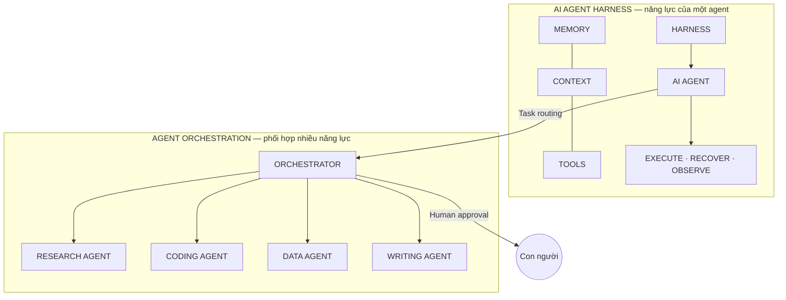

# Triết lý: agent làm phần nặng, con người duyệt 3 điểm

## Tách điều phối khỏi thực thi — không xây một Siêu Agent

Hệ thống tách bạch hai năng lực thay vì gộp vào một agent khổng lồ:

## Ba điểm con người duyệt

Con người không đụng vào từng bước trung gian, chỉ đứng ở **ba cổng duyệt đỏ**:

1. **Đặc tả** — spec được duyệt và đóng băng đúng phiên bản trước khi giao việc.
2. **Mã nguồn** — candidate qua test bảo vệ độc lập mới tới người duyệt.
3. **Sản phẩm** — nghiệm thu trước khi phát hành.

## Everything is a plugin

Các năng lực **thay thế được** nối vào Harness qua những điểm mở rộng rõ ràng:
Model/Runtime, Tools/Connectors, Project Memory, Sandbox, Testing/Verify, Artifact/Delivery.

- Plugin **cung cấp hoặc sử dụng** service, API và event theo contract đã định sẵn.
- Phần core giữ **danh tính, trạng thái, quyền** và kiểm tra tính toàn vẹn (plugin lock).
- ADLC giữ quyền duyệt kế hoạch và nghiệm thu toàn workflow.

## Mở đầu sang kiến trúc

Triết lý này cụ thể hóa thành 4 tầng: [Kiến trúc tổng thể 4 tầng](/docs/architecture/tong-quan-4-tang).
