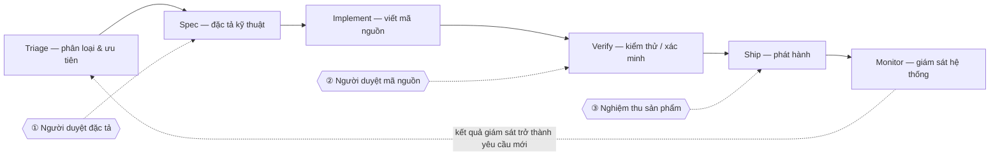

# Vòng đời ADLC: các trạm và cổng duyệt

Mọi đầu việc đi qua các trạm sau; **kết quả giám sát (Monitor) quay về đầu vòng**,
trở thành yêu cầu mới — đây là vòng ADLC cloud-native:

| Trạm | Agent làm | Con người làm |
|---|---|---|
| **Triage** | Phân loại, ưu tiên, gom ngữ cảnh | Chọn thứ tự, xác nhận phạm vi |
| **Spec** | Soạn đặc tả kỹ thuật từ yêu cầu | **① Duyệt đặc tả** — duyệt xong spec **đóng băng** |
| **Implement** | Viết mã nguồn trong sandbox | **② Duyệt mã nguồn** sau khi qua test bảo vệ |
| **Verify** | Chạy kiểm chứng độc lập, thu bằng chứng | Xem bằng chứng, không tin lời agent |
| **Ship** | Chuẩn bị phát hành, PR | **③ Nghiệm thu sản phẩm** trước khi merge |
| **Monitor** | Thu traces/log/metrics, phát hiện lệch | Quyết định cải tiến từ dữ liệu |

## Ba cổng duyệt đỏ

Cả ba trạm có con người đứng giữa đều cùng một nguyên tắc: **agent đề xuất — hệ thống và con
người quyết định**. Cơ chế cụ thể từng cổng trong hệ thống được mô tả ở
[Tầng 2 · Workflow](/docs/architecture/tang-2-workflow) và
[Kiểm chứng độc lập](/docs/architecture/kiem-chung-phuc-hoi/kiem-chung-doc-lap).
