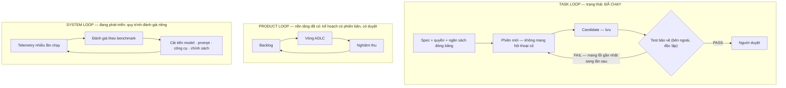

# Cơ chế kiểm chứng — ba vòng cải tiến (2.8a)

Để agent không hallucinate và không suy giảm chất lượng, hệ thống tổ chức **ba vòng lặp**:



Harness phục vụ **Task Loop** · ADLC tổ chức **Product Loop** · quy trình đánh giá riêng tổ chức
**System Loop**. Ta đi vào Task Loop trước — đó là nơi **niềm tin được tạo ra**.

## Task loop — mỗi lần thử bắt đầu lại từ spec cố định

```
Spec + quyền + ngân sách ──▶ PHIÊN MỚI (không mang hội thoại cũ) ──▶ CANDIDATE (lưu)
        đóng băng                                                  │
                                                                   ▼
   FAIL ── mang lỗi gần nhất sang lần sau ◀──── TEST BẢO VỆ (bên ngoài, độc lập)
                                                    │
                                                   PASS ──▶ người duyệt
```

Dừng khi: hết ngân sách · không tiến triển (stall → re-arm, giới hạn số lần) · thiếu thông tin
(xin người dùng qua HITL). Chi tiết cơ chế re-arm:
[SDK & Gateway](/docs/developer-docs/sdk-gateway).

## Ba vòng trong hệ thống này

| Vòng | Thể hiện ở đâu |
|---|---|
| Task loop | Phiên agent trên harness; state machine node; test bảo vệ; re-arm |
| Product loop | Vòng đời ADLC — [các trạm và cổng duyệt](/docs/fundamentals/vong-doi-7-tram) |
| System loop | Ma trận năng lực + benchmark — [Ma trận năng lực](/docs/reference/ma-tran-nang-luc) |
