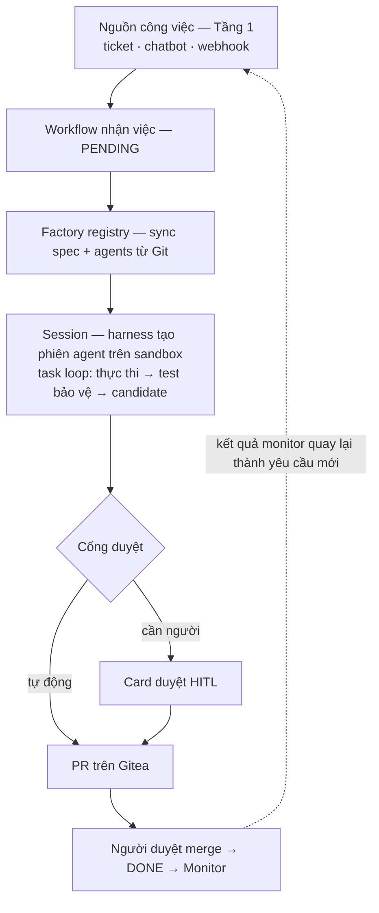
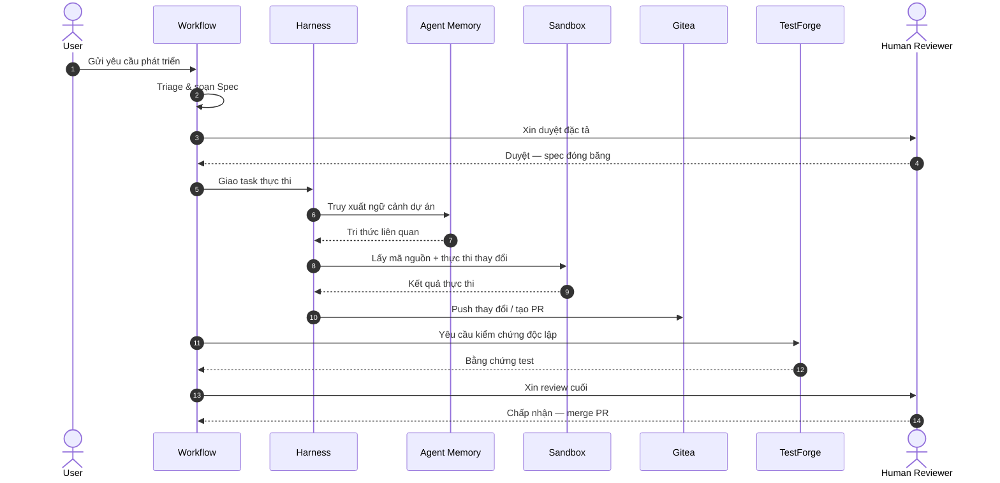

# Luồng hoạt động End-to-End (2.4)

> Sơ đồ gốc nằm trong slide ADLC — xuất hình vào `static/img/02-architecture/` khi có.

Một ticket đi xuyên bốn tầng như sau:

## Từng bước chi tiết

1. **Tiếp nhận** — công việc vào control plane qua một trong các kênh tầng 1; task ở trạng thái
   `PENDING`. Xem: [Trạng thái](/docs/reference/trang-thai).
2. **Đóng băng spec** — spec và agents được sync từ factory repo; kế hoạch được duyệt rồi đóng băng
   đúng phiên bản (contract [TaskLoop](/docs/architecture/giao-tiep#contract-taskloop) và [Git](/docs/architecture/giao-tiep#contract-git)).
3. **Thực thi theo wave** — DAG chạy theo tầng wave; node song song trong wave, có gate chặn giữa.
4. **Kiểm chứng độc lập** — test bảo vệ chạy bên ngoài quyền sửa của agent; PASS/FAIL đều phải có
   bằng chứng (xem [Kiểm chứng độc lập](/docs/architecture/kiem-chung-phuc-hoi/kiem-chung-doc-lap)).
5. **Cổng duyệt** — nếu cần người, run dừng và hiện card duyệt trên dashboard; người duyệt
   chấp nhận/từ chối kèm lý do.
6. **Bàn giao** — thay đổi đi lên nhánh agent trên Gitea; **người duyệt merge**, agent không đẩy
   thẳng `main`.
7. **Giám sát** — traces/log/metrics về Phoenix; kết quả monitor quay lại đầu vòng.

## Sơ đồ tuần tự tham chiếu

Sơ đồ dưới đây là **luồng tham chiếu** để hình dung các hệ thống phối hợp thế nào — các bước tự động
và đường tích hợp thực tế cần **đối chiếu với triển khai** trước khi coi là luồng đang chạy
(liên quan [Known Issues KI-05](/docs/reference/known-issues)):

## Liên quan

- Dữ liệu gì trôi qua từng bước: [Data & Artifact Flow](/docs/architecture/luong-data/data-ma-nguon).
- Gián đoạn giữa chừng thì sao: [Phục hồi gián đoạn](/docs/architecture/kiem-chung-phuc-hoi/phuc-hoi-gian-doan).
- Tự tay chạy luồng này: [Hướng dẫn chạy lần đầu](/docs/user-guides/dung-he-thong-lan-dau).
