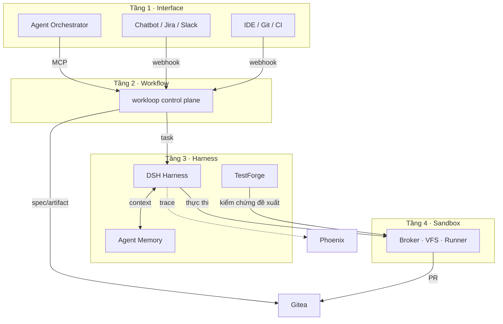

# System Directory — các hệ thống con

ADLC là **hệ thống tổng thể**; các thành phần dưới đây là những hệ thống/năng lực tham gia vào hệ
thống đó. Trang này là bản đồ điều hướng: biết từng thành phần là gì và tài liệu của nó nằm ở đâu.

| Hệ thống con | Vai trò | Trạng thái | Kiến trúc | HDSD |
|---|---|---|---|---|
| **Workflow (workloop)** | Control plane — state machine, factory registry, cổng duyệt | ✅ Đã triển khai | [Tầng 2](/docs/architecture/tang-2-workflow) | [HDSD](/docs/user-guides/workloop-dieu-phoi/cai-dat) |
| **Harness (DSH)** | Agent core — session, taskloop, vault, HITL | ✅ Đã triển khai | [Tầng 3](/docs/architecture/tang-3-harness/tong-quan-harness) | [HDSD](/docs/user-guides/harness-dsh/gioi-thieu) |
| **Sandbox Kit** | Môi trường thực thi cô lập — broker, VFS, provisioner | ✅ Đã triển khai | [Tầng 4](/docs/architecture/tang-4-sandbox) | [HDSD](/docs/user-guides/sandbox-kit/gioi-thieu) |
| **Agent Memory (Cognee)** | Ngữ cảnh dự án — knowledge graph, 3 kho | 🚧 Đang phát triển | [Kiến trúc](/docs/architecture/tang-3-harness/cognee-agent-memory) | [HDSD](/docs/user-guides/agent-memory-cognee/gioi-thieu) |
| **TestForge AI** | Kiểm chứng độc lập — chức năng, hiệu năng, khuyến nghị | ✅ Đã chạy thực nghiệm | [Kiến trúc](/docs/architecture/tang-3-harness/testforge-test-agent) | [HDSD](/docs/user-guides/testforge/gioi-thieu) |
| **Agent Orchestrator** | Giao việc bằng ngôn ngữ tự nhiên + Slack bot | 🚧 Đang hoàn thiện | [Tầng 1](/docs/architecture/tang-1-interface) | [HDSD](/docs/user-guides/opencode-orchestrator/gioi-thieu) |
| **Gitea** | Source of truth — Git repo, webhooks, PR | ✅ Đã triển khai | [Công cụ](/docs/user-guides/cong-cu-ho-tro/gitea) | [HDSD](/docs/user-guides/cong-cu-ho-tro/gitea) |
| **Steel Browser** | Computer use — agent thao tác UI thật | ✅ Đã tích hợp | [Công cụ](/docs/user-guides/cong-cu-ho-tro/steel-browser) | [HDSD](/docs/user-guides/cong-cu-ho-tro/steel-browser) |
| **Playwright + k6** | Test E2E + load test | ✅ Đã tích hợp | [Công cụ](/docs/user-guides/cong-cu-ho-tro/playwright-k6) | [HDSD](/docs/user-guides/cong-cu-ho-tro/playwright-k6) |
| **VFS** | Tệp ảo sống độc lập với phiên thực thi | ✅ Đã triển khai | [Data flow](/docs/architecture/luong-data/data-ma-nguon) | [HDSD](/docs/user-guides/cong-cu-ho-tro/vfs) |
| **Phoenix** | Observability — traces, chi phí model | ✅ Đã tích hợp | [Telemetry](/docs/architecture/luong-data/data-telemetry) | [HDSD](/docs/user-guides/cong-cu-ho-tro/phoenix-observability) |

## Chú giải trạng thái

| Cờ | Nghĩa |
|---|---|
| ✅ **Đã triển khai** | Chạy được, có hướng dẫn thao tác thực tế |
| 🚧 **Đang phát triển / hoàn thiện** | Có nền tảng nhưng chưa đủ cho hướng dẫn thao tác đầy đủ |
| 🔬 **Đã chạy thực nghiệm** | Đã chạy và có kết quả đo; tích hợp liên hệ thống phải đối chiếu trước khi coi là luồng chính thức |
| 📐 **Đề xuất** | Có thiết kế, chưa khẳng định đã tích hợp hoàn chỉnh |

> Lưu ý quan trọng: một số kết nối liên hệ thống (ví dụ **TestForge chạy trong Sandbox Kit**) là
> hướng tích hợp **cần kiểm chứng end-to-end** — xem
> [TestForge](/docs/architecture/tang-3-harness/testforge-test-agent). Không viết thành hướng dẫn
> của tính năng "đã có sẵn" cho đến khi có bằng chứng chạy thật.

## Quan hệ giữa các hệ thống con

