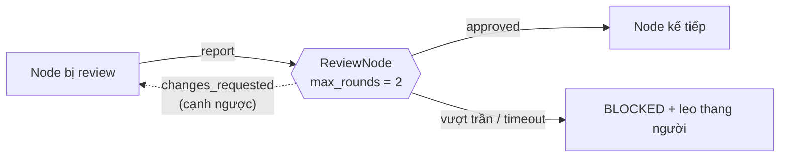

# Cổng duyệt & HITL — ba chốt đỏ

**Người đề xuất không tự duyệt.** Đây là nguyên tắc duy nhất cả trang quay quanh, và là lý do hệ
thống có ba "chốt đỏ" trên đường đi của sản phẩm: **đặc tả → mã nguồn → sản phẩm**. Tới chốt, run
tự dừng và gọi người can thiệp (HITL — human-in-the-loop) hoặc reviewer agent; mọi quyết định được
ghi vào log trung lập.

:::info[Quyết định thuộc người]

MCP không có tool "duyệt" — agent orchestrator không tự gật thay người. Ai đề xuất thì người khác
duyệt: PR spec cấm tự duyệt ở mức module, reviewer agent là session riêng, duyệt sản phẩm là
người.

:::

## Ba chốt nhìn từ trên cao

| Chốt | Duyệt cái gì | Cơ chế | Điểm chống gian lận |
|---|---|---|---|
| ① Đặc tả | Thay đổi spec trong quy trình có kiểm soát | Cổng PR `/api/v1/spec-pr` | `allow_self_approval=false` — cấm tự duyệt ở mức module |
| ② Mã nguồn | Kết quả từng node khai `need_review` | Node review: agent hoặc hàng đợi người | Reviewer là session mới mỗi vòng; bộ đếm vòng do engine giữ |
| ③ Sản phẩm | Vòng đời sản phẩm: tài liệu spec, PR triển khai | `/api/v1/lifecycle` | Đủ điều kiện mới được coi là kết thúc |

## ① Chốt đặc tả — cổng PR spec

Thay đổi spec trong quy trình có kiểm soát đi qua `/api/v1/spec-pr`:

```
propose (author, spec mới, title) → approve (min_approvals, cấm tự duyệt) → merge (ghi file + commit)
```

- **Cấm push thẳng** spec trong quy trình có duyệt; merge chỉ xảy ra khi đủ ngưỡng duyệt.
- Cơ chế cấm tự duyệt ở mức module (`allow_self_approval=false`) — **không phụ thuộc người dùng
  tự giác**.
- Đầy đủ audit trail: danh sách PR spec + log duyệt.

## ② Chốt mã nguồn — node review

Node khai `need_review` để mở cổng sau khi nó xong:

| Chế độ | Cơ chế |
|---|---|
| `none` | Không review — chỉ chạy tiếp |
| `agent` | Session **reviewer** duyệt: đọc report + bằng chứng, trả phán quyết dòng đầu `APPROVED` / `CHANGES_REQUESTED: <lý do>`; không kết luận rõ → **fail-closed** (chặn) |
| `human` | Nộp vào **hàng đợi duyệt** (HITL) — chờ người ra quyết định |

Cổng review là **node riêng trên graph** — không phải thuộc tính giấu trong node:



**Vòng sửa–chạy diễn ra thế nào:**

1. Chưa đạt → engine **resume đúng session đã dừng** của node bị review, gửi feedback của
   reviewer (kèm yêu cầu cập nhật report ghi mục "Fix report vòng N") — node **sửa trong context
   cũ**, không làm lại từ đầu.
2. Nếu giữa node bị review và gate còn node khác → chúng được **chạy lại theo thứ tự topo** —
   đầu vào của chúng đã đổi.
3. Vượt trần (`max_rounds`, mặc định 2) hoặc hết giờ chờ người → `BLOCKED` + leo thang; lối
   `approved` trả SKIP marker → **nhánh xuống không chạy** (fail-closed).

**Ba quy tắc chống gian lận của vòng review:**

- **Bộ đếm vòng do ENGINE giữ** (`max_rounds`) — không tin agent tự khai.
- **Reviewer là session mới mỗi vòng** (nguyên tắc maker-checker — người review vòng sau không
  mang định kiến vòng trước); reviewer được truyền tiêu chí + skill + **toàn bộ input của gate**
  làm bằng chứng.
- **Lineage đầy đủ trong event trail**: `node_review_rejected` (lý do) → `node_review_pending`
  (vòng N) → `node_review_done` / `node_review_exhausted`.

## Hàng đợi duyệt người (ApprovalQueue)

Khi duyệt là việc của người, quyết định không đứng chờ *trong* run — nó nằm trong một **hàng đợi
có kỷ luật**:

| Tính chất | Giá trị |
|---|---|
| Vòng đời record | `pending → approved → spawned` hoặc `pending → rejected` |
| Quyết định | **Bất biến** — đã approved/rejected không đổi |
| Một lần | Payload chỉ rời hàng đợi qua `take_approved()` — đúng một lần |
| Trùng lặp | `dedup_key` — hai request chờ cho cùng một việc là lỗi |
| TTL | 48h không ai trả lời → swept thành rejected — không treo badge duyệt vĩnh viễn |

**Đường HITL trong run** — supervisor poll gateway mỗi ~10s:

1. Agent/gateway hỏi người (approval/question/permission) → event `approval_requested`
   (`event_id`, `kind`, `summary`).
2. Người (hoặc delegate được ủy quyền) trả lời qua
   `POST /monitor/jobs/{id}/approvals/{event_id}/answer` với `decision` +
   `by: human | delegate:<id>` — ghi vào `approval_answered` để audit.
3. Backend chỉ **trung chuyển** — không tự trả lời thay người; run kết thúc thì endpoint trả 409
   (không còn gateway sống để trả lời).

## ③ Chốt sản phẩm — lifecycle duyệt

Chốt cuối theo dõi **sản phẩm**, không phải node. Vòng đời sản phẩm theo dõi qua
`/api/v1/lifecycle` (tạo idempotent theo trigger — ví dụ Slack thread): tài liệu spec (đăng ký +
**duyệt**) → PR triển khai (`record_pr` + `review`) — đủ điều kiện trước khi vòng được coi là kết
thúc.

Ví dụ điển hình: agent `spec` soạn tài liệu lên Confluence → người duyệt trang → workflow triển
khai mới được phép chạy.

## Duyệt từ đâu

- **Dashboard** — tab **Duyệt**: card kèm brief, sản phẩm, bằng chứng, tiêu chí →
  [Giao diện dashboard](/docs/user-guides/workloop-dieu-phoi/giao-dien-dashboard).
- **REST** — [API REST](/docs/reference/api-rest) (approvals, spec-pr, lifecycle, reviews).
- MCP không có tool "duyệt" — quyết định thuộc **người** (nhắc lại vì quan trọng: agent
  orchestrator không tự gật thay).

## Liên kết

- Vai trò & quyền theo luồng duyệt: [Phân quyền tài khoản](/docs/admin-operations/phan-quyen-tai-khoan)
- Review không đạt trong runbook: [RB-02 · Node BLOCKED](/docs/admin-operations/runbook-su-co)
- Vì sao có 3 chốt: [Năm câu hỏi](/docs/fundamentals/nam-cau-hoi)
