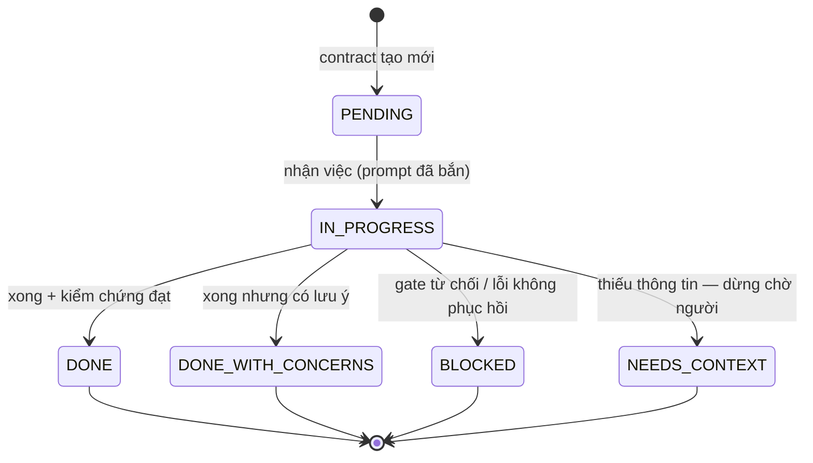

# State machine vòng đời task

**Mỗi node nhận việc là có một hợp đồng giao khoán: agent tự kê khai tiến độ, phòng điều hành
kiểm chéo chứ không tin mù.** Tầng 2 quản lý trạng thái ở **hai cấp** độc lập:

- **Trạng thái *node*** — hợp đồng taskloop nằm trên harness (tầng 3). Đây là **trạng thái thật**.
- **Trạng thái *job*** — run trên backend. Chỉ là vòng đời điều phối.

Hai cấp độc lập — node chết không làm job chết.

## Trạng thái node — hợp đồng 6 trạng thái

Mỗi node khi được giao việc có một **contract** định danh `<workflow>--<node>--<run>` trên harness
(tầng 3). Bộ 6 trạng thái chuẩn là **hợp đồng đóng băng** — harness nào (DSH, OpenCode…) cũng
phải map trạng thái native về đây; engine không hiểu gì khác ngoài 6 trạng thái này:



| Trạng thái | Ẩn dụ | Terminal? | Ý nghĩa |
|---|---|---|---|
| `PENDING` | Đã ký hợp đồng, chưa lên đường | — | Contract đã có, chưa nhận việc |
| `IN_PROGRESS` | Đang làm, chịu giám sát | — | Agent đang thực thi (chịu giám sát stall → re-arm) |
| `DONE` | Nghiệm thu đạt | ✅ | Xong, đạt — trạng thái duy nhất **gate chấp nhận** |
| `DONE_WITH_CONCERNS` | Nghiệm thu kèm lưu ý | ✅ | Xong nhưng có lưu ý — node thường cho qua, **gate chặn** |
| `BLOCKED` | Bế tắc, cần người mở đường | ✅ | Không tiếp tục được — leo thang người vận hành |
| `NEEDS_CONTEXT` | Dừng tay xin thêm tài liệu | ✅ | Thiếu thông tin — tách escalation khỏi logic run |

### Hai trạng thái cấp engine — ngoài hợp đồng agent

Ngoài bộ chuẩn, engine còn dùng hai trạng thái **cấp gateway/engine** (không thuộc contract
agent):

- `CANCELLED` — gateway hủy phiên (STOP, dọn dẹp khi job chết).
- `SKIPPED` — engine bỏ node theo điều kiện (nhánh Condition không đi, join policy gạt nhánh
  upstream đã skip, review không đạt sau trần vòng). Ghi kèm `why` vào event.

:::note[Terminal ≠ kết thúc xử lý nghiệp vụ]

`DONE_WITH_CONCERNS`, `BLOCKED`, `NEEDS_CONTEXT` là **terminal của contract** — agent dừng, engine
không tự vòng lại. Việc xử lý tiếp (bổ sung brief, cung cấp ngữ cảnh, chạy lại) là **quyết định
cấp workflow**: sửa spec rồi `fresh=true`, hoặc chạy lại với `resume` — xem
[Chịu lỗi & phục hồi](/docs/architecture/tang-2-workflow/chiu-loi-phuc-hoi).

:::

## Ai ghi trạng thái — và sao tin được

Ba vai, tách bạch rõ ràng:

1. **Agent kê khai.** Agent tự cập nhật contract theo quy trình taskloop: `IN_PROGRESS` khi bắt
   đầu, terminal status **trước khi** gửi report (quy tắc "set final status BEFORE sending this
   report" nằm ngay trong template prompt). Sau khi set terminal, agent không được sửa report nữa
   (chống late-write race với reviewer).
2. **Engine kiểm chéo — không tin mù.** Node kết thúc mà contract chưa terminal → engine chờ 1
   nhịp (30s), đọc lại contract; vẫn không terminal → coi là `DONE_WITH_CONCERNS` + event
   `node_status_unclear`. Không bao giờ âm thầm coi là `DONE`.
3. **Engine quyết định qua/không qua.** Gate chỉ nhận `DONE`; `DONE_WITH_CONCERNS` lọt tới gate
   bị chặn — tránh "xong ẩu" qua cổng duyệt.

## Trạng thái job — vòng đời một run

| Trạng thái | Bật bởi | Ý nghĩa |
|---|---|---|
| `queued` | `POST /flows/{name}/run` | Job đã tạo trong DB, runner chưa nhặt |
| `in_progress` | runner | DAG đang chạy theo wave |
| `completed` | kết thúc sạch | Mọi node đã terminal; `result` = tổng hợp status + attempts từng node |
| `suspended` | signal `PAUSE` | Dừng có **checkpoint** — `resume_run` tiếp tục được |
| `cancelled` | signal `STOP` / hủy | Dừng hẳn |
| `failed` | exception tầng DAG | Lỗi engine/gateway — xem `error` + event `job_failed` |

## Event trail — sổ ghi chỉ thêm, không xoá

Backend ghi **event log chỉ append** vào bảng `job_events` (mỗi job một dãy `seq`). Chuỗi sự kiện
chuẩn của một run:

```
job_created → run_context → run_start → node_started → node_terminal
           → node_done (status + attempts + errors taxonomy) → job_completed
```

Các event khác: `approval_requested` / `approval_answered` (HITL, có `by` audit),
`node_review_pending/rejected/done/exhausted` (vòng review), `skill_injected` /
`artifact_injected` (bằng chứng node nhận đủ ngữ cảnh), `job_paused` / `run_resumed` /
`job_resumed` (phục hồi). `node_started`/`node_terminal` ghi theo **thời điểm thật** — là nguồn
span cho Gantt timeline và trace Phoenix.

### Hai đường sự kiện — không trộn

| Đường | Nơi sống | Dùng cho |
|---|---|---|
| `job_events` (SQLite) | DB backend — trail đầy đủ | `get_run`, timeline Gantt, audit |
| Event bus (SSE) | `/api/v1/events/stream/{run_id}` — replay + live theo `seq`, type theo hợp đồng đóng băng (`run.started`, `gate.waiting`…) | Dashboard/FE thời gian thực |

Vì sao tách hai đường: trail trong DB phải **đầy đủ** (audit không được thiếu), còn stream cho
dashboard phải **nhanh và live** — hai yêu cầu, hai cơ chế.

## Liên kết

- Bảng trạng thái tra cứu nhanh: [Trạng thái & State machine](/docs/reference/trang-thai)
- Trạng thái đọc từ đâu: [MCP Tools](/docs/reference/mcp-tools) (`get_run`, `get_report`) ·
  [API REST](/docs/reference/api-rest)
- Khi trạng thái dừng giữa chừng: [Chịu lỗi & phục hồi](/docs/architecture/tang-2-workflow/chiu-loi-phuc-hoi)
