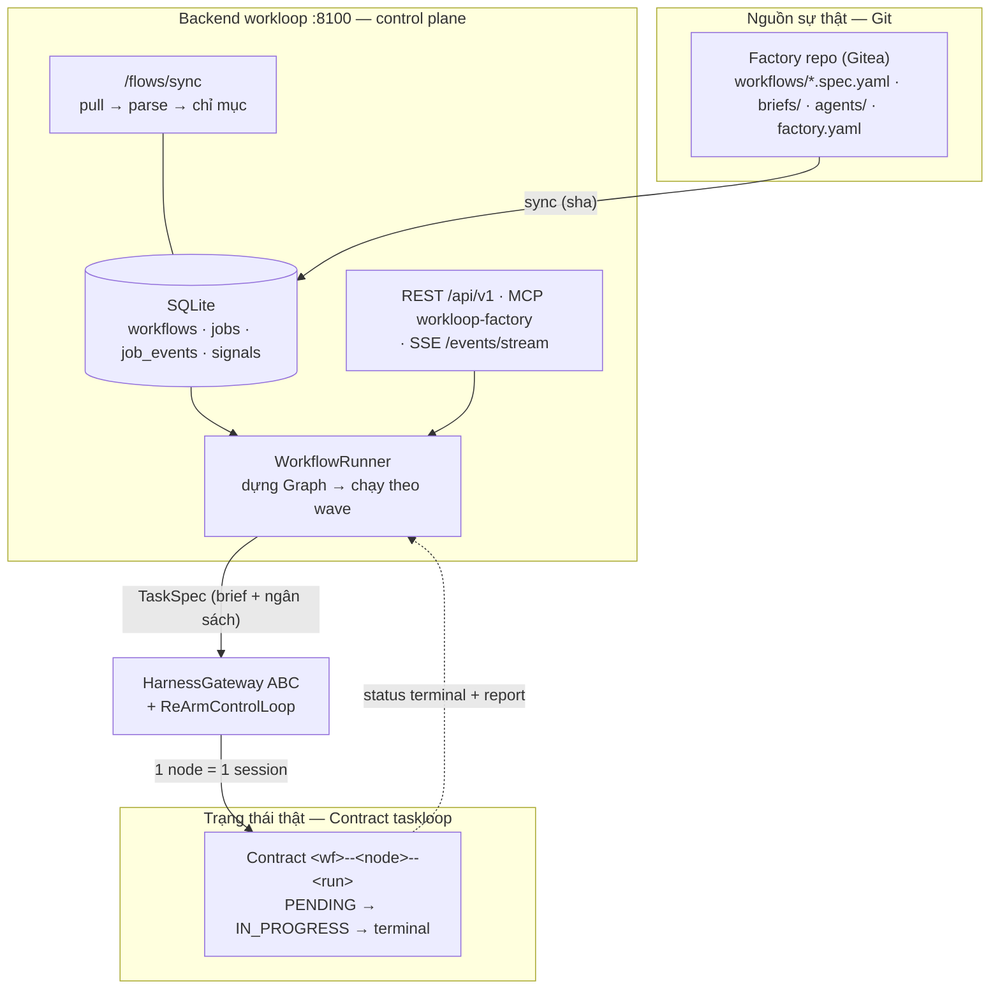

# Tầng 2 · Workflow — control plane

> Grounded vào mã nguồn `workloop` (backend FastAPI `:8100`, engine DAG lfx vendored, gateway taskloop).

Agent ở Tầng 3 là **công nhân** — người cầm dụng cụ làm việc thật. Tầng 2 là **phòng điều hành**: không cầm dụng cụ, không thực thi công việc — chỉ ra quyết định và giữ sổ. Nó trả lời ba câu hỏi:

- **Chạy cái gì?** — *factory registry*: workflow lấy từ Git, không nằm trong DB.
- **Đang chạy tới đâu?** — *state machine vòng đời*: trạng thái thật nằm trong contract của từng node.
- **Được phép đi tiếp không?** — *cổng duyệt*: ba chốt đỏ, người quyết định — không phải agent.

Và khi có sự cố, nó còn phải trả lời câu thứ tư: **hỏng thì sao?** —
[Chịu lỗi & phục hồi](/docs/architecture/tang-2-workflow/chiu-loi-phuc-hoi).

## Câu chuyện một run

Cách dễ nhất để hiểu control plane là đi theo một run từ đầu đến cuối:

1. **Lấy bản vẽ từ sổ.** Workflow không nằm trong backend — nó là file spec trong **factory repo**
   (Gitea), sửa bằng commit như mọi tài liệu có lịch sử. Backend **sync** về và chỉ giữ bản chỉ
   mục; mỗi lần sync ghi lại đúng SHA — run nào cũng biết mình chạy theo bản vẽ phiên bản nào.
   → [Factory registry](/docs/architecture/tang-2-workflow/factory-registry)
2. **Dựng sơ đồ thi công.** Nhận lệnh chạy, runner biên dịch spec thành **DAG** — sơ đồ phụ thuộc
   giữa các node — rồi thi công theo **wave**: việc không phụ thuộc nhau chạy song song, mỗi node
   một session agent riêng. → [Thực thi DAG](/docs/architecture/tang-2-workflow/thuc-thi-dag)
3. **Ký hợp đồng giao việc.** Node nào được giao việc thì có một **contract**
   `<wf>--<node>--<run>` trên harness, kèm brief + ngân sách đầy đủ. Hợp đồng dùng bộ **6 trạng
   thái chuẩn** để backend và agent nói cùng một thứ tiếng về tiến độ.
   → [State machine vòng đời](/docs/architecture/tang-2-workflow/state-machine)
4. **Kê khai và kiểm chéo.** Agent tự kê khai trạng thái (`IN_PROGRESS` khi bắt đầu, terminal khi
   xong). Engine **không tin mù**: node kết thúc mà chưa kê khai, engine chờ rồi đọc lại — vẫn
   không thấy thì ghi `DONE_WITH_CONCERNS` kèm cảnh báo, không bao giờ âm thầm coi là xong.
   → [State machine vòng đời](/docs/architecture/tang-2-workflow/state-machine)
5. **Dừng ở chốt duyệt.** Tại ba điểm trên đường đi — **đặc tả**, **mã nguồn**, **sản phẩm** —
   run dừng chờ người (hoặc reviewer agent) quyết định. Ai đề xuất thì người khác duyệt; quyết
   định ghi vào log trung lập. → [Cổng duyệt & HITL](/docs/architecture/tang-2-workflow/cong-duyet-hitl)
6. **Sự cố và kết thúc.** Phiên rớt, provider rate-limit, người duyệt vắng mặt — đều là chuyện
   bình thường: cơ chế chịu lỗi **re-arm** phiên, **pause/resume** có checkpoint; job kết thúc
   (dù cách nào) thì mọi session còn sống bị hủy — không còn agent mồ côi đốt token.
   → [Chịu lỗi & phục hồi](/docs/architecture/tang-2-workflow/chiu-loi-phuc-hoi)

## Sơ đồ tổng thể — đọc thế nào

Mỗi khối trong sơ đồ ứng với một cảnh ở trên:

| Khối | Cảnh |
|---|---|
| `Nguồn sự thật — Git` → `/flows/sync` → SQLite | Cảnh 1 — sync từ Gitea về bản chỉ mục |
| `WorkflowRunner` | Cảnh 2 — dựng Graph, chạy theo wave |
| Mũi tên `TaskSpec` → khối `Contract` | Cảnh 3 — giao việc, ký hợp đồng |
| Mũi tên đứt `status terminal + report` | Cảnh 4 — agent kê khai, engine kiểm chéo |

Cổng duyệt và cơ chế chịu lỗi không vẽ trong sơ đồ này — mỗi cái là một trang riêng (Cảnh 5, 6).

## Từ vựng tối thiểu — 6 trạng thái của node

Các trang sau dùng thoải mái những trạng thái này; đây là bản tra nhanh (ẩn dụ để dễ nhớ —
định nghĩa chính xác ở [trang State machine](/docs/architecture/tang-2-workflow/state-machine)):

| Trạng thái | Ẩn dụ | Ý nghĩa |
|---|---|---|
| `PENDING` | Đã ký hợp đồng, chưa lên đường | Contract đã có, chưa nhận việc |
| `IN_PROGRESS` | Đang làm, chịu giám sát | Agent đang thực thi (stall → re-arm) |
| `DONE` | Nghiệm thu đạt | Xong, đạt — **trạng thái duy nhất cổng duyệt chấp nhận** |
| `DONE_WITH_CONCERNS` | Nghiệm thu kèm lưu ý | Xong nhưng có lưu ý — node thường cho qua, **gate chặn** |
| `BLOCKED` | Bế tắc, cần người mở đường | Không tiếp tục được — leo thang người vận hành |
| `NEEDS_CONTEXT` | Dừng tay xin thêm tài liệu | Thiếu thông tin — dừng chờ người |

## Bốn nguyên tắc thiết kế

Mỗi nguyên tắc có hai lớp: một câu đời thường, và ý nghĩa khi đọc mã nguồn.

| Nguyên tắc | Nói đời thường | Ý nghĩa trong mã nguồn |
|---|---|---|
| **Git là nguồn sự thật của spec** | Công thức nằm trong sổ, không nằm trong đầu bếp — sửa bản vẽ thì sửa sổ, không sửa trí nhớ | Sửa spec = commit + push; run lưu `sha` để trace ngược đúng phiên bản; sync tự prune workflow không còn trong tree |
| **Contract là nguồn sự thật của trạng thái** | Sổ kê khai trên tay người làm việc là bằng chứng — nhật ký của phòng điều hành chỉ để tra cứu | Engine chỉ đọc/ghi trạng thái qua DTO `Contract`; DB không phải nơi quyết định |
| **Kiểm soát ở ranh giới là code, không nhờ LLM** | Đèn giao thông không hỏi ý kiến người lái xe | Điều kiện rẽ nhánh, bộ đếm vòng review, gate `DONE`-only đều là code deterministic — LLM không được tự chế trạng thái |
| **Fail-closed** | Không rõ thì coi là chưa đạt — không có trạng thái "âm thầm coi là xong" | Thiếu ngữ cảnh → `NEEDS_CONTEXT`; reviewer không kết luận rõ → chặn; node không set terminal → `DONE_WITH_CONCERNS` có cảnh báo |

## Các trang trong mục này

Mỗi trang trả lời một câu hỏi của dòng đời một run:

| Câu hỏi | Trang | Nội dung |
|---|---|---|
| Chạy **cái gì**? | [Factory registry](/docs/architecture/tang-2-workflow/factory-registry) | Spec sống trong Git, sync, phiên bản hoá, configure, run context |
| Chạy **thế nào**? | [Thực thi DAG](/docs/architecture/tang-2-workflow/thuc-thi-dag) | Spec → DAG, wave song song, join policy, rẽ nhánh, node types |
| Biết đang **tới đâu**? | [State machine vòng đời](/docs/architecture/tang-2-workflow/state-machine) | 6 trạng thái contract, trạng thái job, ai ghi trạng thái, fail-closed |
| Được **đi tiếp** không? | [Cổng duyệt & HITL](/docs/architecture/tang-2-workflow/cong-duyet-hitl) | 3 chốt đỏ, vòng review lặp, hàng đợi duyệt người |
| **Hỏng** thì sao? | [Chịu lỗi & phục hồi](/docs/architecture/tang-2-workflow/chiu-loi-phuc-hoi) | Re-arm, taxonomy lỗi, PAUSE/RESUME checkpoint, resume node-level |

:::info[Hướng dẫn sử dụng]

Kiến trúc ở trên trả lời câu hỏi **"hệ thống vận hành thế nào"**; để **tự tay vận hành**, đi theo
trình tự: [cài đặt](/docs/user-guides/workloop-dieu-phoi/cai-dat) một lần →
[vòng 4 bước](/docs/user-guides/workloop-dieu-phoi/vong-4-buoc)
(configure → run → quan sát → review) → [xử cố](/docs/user-guides/workloop-dieu-phoi/xu-co) khi
run treo hoặc lỗi. Tra nhanh trong lúc làm: [MCP Tools](/docs/reference/mcp-tools) ·
[API REST](/docs/reference/api-rest) · [Trạng thái](/docs/reference/trang-thai).

:::
