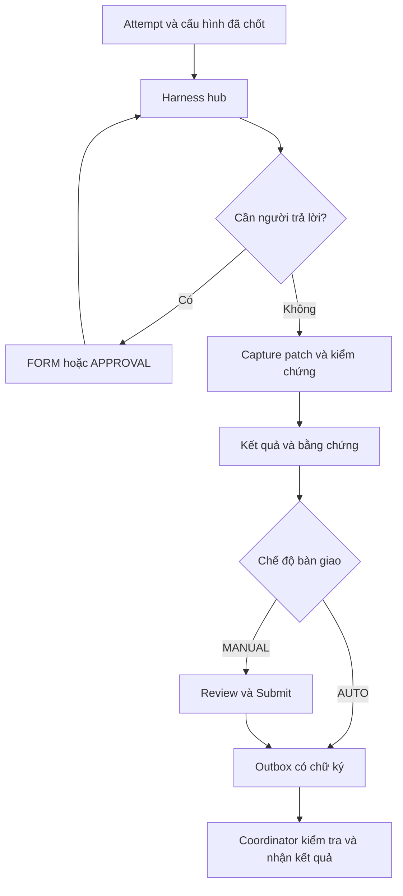

# Contract và bằng chứng thực thi

Execution hub trong ADLC nhận task attempt qua REST API, giữ lịch sử thực thi và chuyển
kết quả về coordinator. Cơ chế này bổ sung định danh, plugin integrity và artifact có bytes
thật để kiểm tra.

## Định danh attempt

Coordinator lưu request trước dispatch, gắn `request_id`, `workflow_run_id`, `task_run_id`
và `attempt_id`. Hub nhận `idempotency_key` cùng cấu hình execution đã pin. Một retry cần
phân biệt đọc lại submission cũ với tạo attempt mới.

`plugin_lock` ghi plugin ID, version và digest nội dung. Hub kiểm tra bytes cài đặt khi
khởi động và trước execution; mismatch làm readiness hoặc execution báo lỗi. Profile cũng
pin operation và schema kết quả. Thay model, policy hoặc lock của lượt đang dở cần được
xử lý qua kế hoạch/lần chạy mới theo cơ chế của coordinator.

## Tương tác trong lúc chạy

`FORM` thu thông tin còn thiếu; `APPROVAL` nhận quyết định cho tương tác đang pause.
Phản hồi gắn với session và interaction ID, rồi chuyển về đúng tool call đang chờ. Đây là
tương tác thực thi. Lifecycle approval của workflow là bản ghi quyết định riêng.

Trong Workloop, người dùng xử lý card Duyệt theo gateway hiện có. Không cần dùng một câu xác
nhận ở phiên chat khác làm phản hồi cho interaction của hub.

## Capture Git patch

Collector tham chiếu tạo checkout riêng từ committed source revision do deployment cấp.
Agent làm việc trong checkout đó, collector lấy tracked diff và các file untracked hợp lệ
so với base commit. Working tree không sạch của source sẽ không được sao chép vào candidate.

Artifact gắn correlation, base commit, checksum SHA-256, kích thước và time limit cho việc đọc bytes.
Coordinator giữ bytes trước khi chấp nhận terminal result. Review/download của attempt cũ
đọc kho đã lưu, không yêu cầu agent kể lại thay đổi hay capture lại source hiện tại.

Checkout riêng giúp tách thay đổi giữa session. Chính sách filesystem, network và command
vẫn do runtime/deployment áp dụng; collector allowlist chỉ giới hạn nội dung được xuất.
Hướng dẫn kiểm tra nằm ở [đọc kết quả](/docs/user-guides/harness-dsh/kiem-tra-ket-qua).

## Contract đặc tả

Contract đặc tả có revision, reference và nội dung đã được con người duyệt. Profile
authoring soạn tài liệu qua các tool được cấp. Profile execution nhận reference đã chốt,
giới hạn path/action và tạo evidence theo criterion.

Các predicate đã thấy trong source execution gồm có source patch, source không đổi và
cú pháp JSON của file thay đổi. Chúng không chạy một lệnh tùy ý lấy từ description.
Evidence giữ `natural_language_enforced: false`; yêu cầu nghiệp vụ bằng ngôn ngữ tự nhiên
chưa được chứng nhận chỉ nhờ các predicate này.

`vai-adlc-verify-structured` cũng chỉ kiểm tra cấu trúc/output bắt buộc. Chạy unit test,
kiểm thử UI và tải cần verifier/runner riêng, chẳng hạn TestForge với cấu hình phù hợp.

## Review và bàn giao

Trong chế độ `MANUAL`, result đã chuẩn bị chờ Submit. Người review xem patch, verdict và
điểm còn thiếu trước thao tác này. Contract approval, plan acceptance, trả lời interaction
và Submit kết quả là các quyết định ở những thời điểm khác nhau.

Outbox gửi kết quả cùng delivery ID. Hub ký timestamp và bytes body bằng HMAC-SHA256;
coordinator kiểm tra chữ ký, correlation và callback trùng trước khi nhận kết quả cho
attempt. Callback tới được backend chưa chứng minh code đạt test hoặc đã được phép merge.

## Phục hồi verification

Profile H5D `vai-adlc-contract-recovery` lưu checkpoint trước khi gửi proof sang ADLC.
Checkpoint giữ request digest, binding, candidate bytes, artifact identity và proof gốc.
Sau restart, recovery đọc lại đúng dữ liệu này để publish hoặc nhận lại proof đã lưu.

| Tình huống | Hành vi của profile recovery |
|---|---|
| Có checkpoint, proof chưa lưu | Gửi proof gốc và khôi phục candidate gốc |
| Proof đã lưu nhưng mất acknowledgement | Đối chiếu proof gốc, giữ nguyên định danh |
| Bridge tạm offline | Giữ `VERIFYING`, chờ đối soát tiếp |
| Thiếu/hỏng checkpoint, khác binding hoặc patch hết hạn | Báo lỗi, cần quyết định attempt mới |
| Model bị gián đoạn trước checkpoint hoàn chỉnh | Không tự resume hay gửi prompt thay thế |

Recovery thành công vẫn chờ review/Submit ở chế độ `MANUAL`. Nó không chạy lại model, reset
proof hoặc tạo patch mới để khớp kết quả cũ. Profile execution gốc và recovery không được
bật chồng khi cùng đăng ký các tool name.

## Áp dụng vào Workloop

Source ADLC là căn cứ cho thiết kế và hành vi của các plugin riêng. Muốn Workloop dùng
execution hub cần adapter phù hợp, cấu hình auth/callback, ánh xạ trạng thái và kiểm tra
lưu artifact theo job/node. Cài DSH hoặc đổi `harness.kind` không hoàn thành các bước đó.

Đối chiếu [giao diện Harness](/docs/reference/harness-interfaces) trước khi triển khai.
Phần sử dụng Workloop hiện tại nằm ở [vận hành Harness](/docs/user-guides/harness-dsh/van-hanh-workloop).
