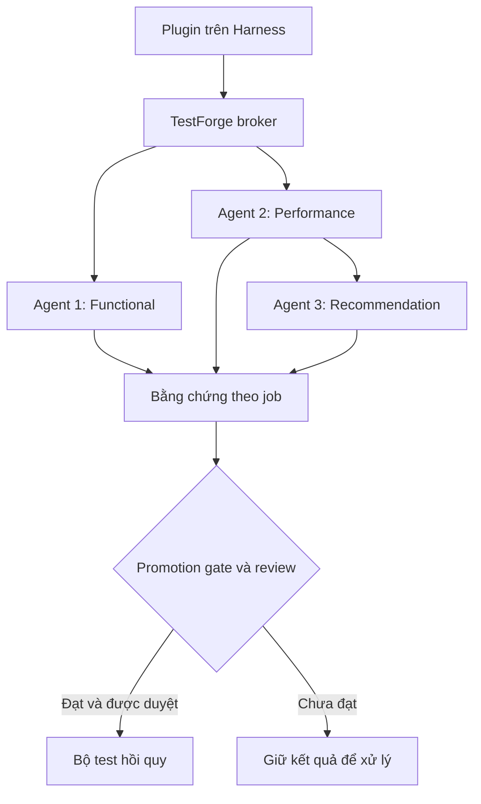

# TestForge AI — kiểm chứng độc lập

## Vai trò: quan sát viên bên ngoài

TestForge hiện thực hóa nguyên tắc [kiểm chứng độc lập](/docs/architecture/kiem-chung-phuc-hoi/kiem-chung-doc-lap):
**agent làm việc nói "xong" chưa phải là xong** — phải có bằng chứng từ bên quan sát không nằm
trong quyền sửa của agent thực thi. TestForge đồng hành xuyên suốt SDLC:

| Giai đoạn | Hoạt động | Mức độ |
|---|---|---|
| 01 Phân tích yêu cầu | Tài liệu phân tích làm căn cứ kiểm thử | Hỗ trợ |
| 02 Thiết kế | Tham chiếu đặc tả hệ thống | Tham chiếu |
| 03 Phát triển | Chạy test sớm, phát hiện lỗi, gợi ý tối ưu | Hỗ trợ trực tiếp |
| 04 Kiểm thử | Sinh, chạy test chức năng + đo tải k6 | **Trọng tâm** |
| 05 Phát hành | Cung cấp kết quả kiểm tra trước release | Hỗ trợ |

## Ba agent

- **Agent 1 · Functional** — yêu cầu → kịch bản → bằng chứng thực thi (runner Playwright;
  khám phá UI thật để tạo locator/trace).
- **Agent 2 · Performance** — trace/OpenAPI → workload k6 → chạy tải → đánh giá ngưỡng
  (p50/p95/p99, tỷ lệ lỗi, throughput).
- **Agent 3 · Recommendation** — kết quả Agent 2 → nguyên nhân khả dĩ + khuyến nghị + kế hoạch xác
  minh (LLM phân tích; Dev kiểm chứng trước khi kết luận).

Kết quả hiệu năng phân loại **PASS / PASS_WITH_WARNING / FAIL** theo target và biên chấp nhận;
khuyến nghị tối ưu **không tự sửa mã nghiệp vụ** — luôn có bước xác minh tiếp theo.

## Promotion gate — chấp nhận bài test vào bộ chuẩn

Một luồng test chỉ vào được bộ test chuẩn (regression) khi qua gate kiểm tra, ví dụ:

- `step_coverage` — độ bao phủ bước (tối thiểu theo cấu hình, ví dụ ≥ 80% grounded).
- `oracle_from_contract` — bước ASSERT bám kỳ vọng đã duyệt.
- `replay_pass` — chạy lại được với kết quả xác minh.
- `video_evidence` — bằng chứng video không rỗng.

Kết quả tổng thể: **PASS / HEALED_PASS / FAIL / ERROR / PARTIAL** — chỉ PASS/HEALED_PASS qua gate
và được duyệt mới đưa vào regression.

`HEALED_PASS` có nghĩa test/locator đã thay đổi. Cần giữ kết quả gốc và review revision mới;
không coi việc tự heal bộ test chuẩn là bằng chứng ứng dụng đã đạt với suite ban đầu.

## Bằng chứng

Mỗi lần chạy lưu theo mã job: **script, ảnh, trace, video, log, báo cáo k6** tùy pipeline và cấu
hình. Chúng cần được lưu ngoài vòng đời phiên thực thi để dùng cho hồi quy và đối chiếu.

## Kết nối với Harness và Workloop

`vai_testforge` đăng ký các tool trong DSH. Khi agent gọi tool, plugin kết nối HTTP tới broker;
broker tổ chức pipeline và runner thực thi. Đây là ba thành phần khác nhau: cài plugin không
tự dựng broker, cài trình duyệt hoặc cấp tài khoản SUT.

Trong deployment tham chiếu, broker khởi chạy runner trên host đã cấu hình. Vị trí runner và
việc chạy trong Sandbox Kit phải được xác nhận theo môi trường; không suy ra tích hợp Sandbox
Kit chỉ từ tên TestForge hoặc việc Harness đang chạy trong container.

Workloop giao node QA qua gateway DSH. Report cần nối được Workloop job ID, session ID và
TestForge job ID. `completed` của broker là trạng thái thực thi; PASS/FAIL của testcase và
quyết định chấp nhận của người duyệt là hai kết luận riêng.

| Luồng | Điểm vào plugin | Mục đích |
|---|---|---|
| Yêu cầu kiểm thử mới | `testforge_command` | Preview rồi xác nhận để chạy functional/perf |
| Sinh test/khám phá | `testforge_explore`, `testforge_orchestrate` | Tạo testcase và bằng chứng; cần review trước khi làm bộ chuẩn |
| Hồi quy đã duyệt | `testforge_replay`, `testforge_staging` | Đối chiếu session/suite cụ thể |
| Đọc kết quả | `testforge_result`, `testforge_evidence` | Tra job và evidence đúng phạm vi |

Workflow hồi quy có cổng duyệt và hướng dẫn đọc kết quả nằm tại
[Tích hợp TestForge vào Workloop](/docs/user-guides/testforge/tich-hop-workloop).

:::info[Hướng dẫn sử dụng]

Trang này trả lời TestForge **là gì và vì sao đáng tin**; phần vận hành — chuẩn bị đầu vào (yêu cầu,
contract đã duyệt), quy trình 4 bước và cách thẩm định từng loại bằng chứng trước khi tin kết quả
PASS — nằm ở [HDSD TestForge](/docs/user-guides/testforge/gioi-thieu).

:::
