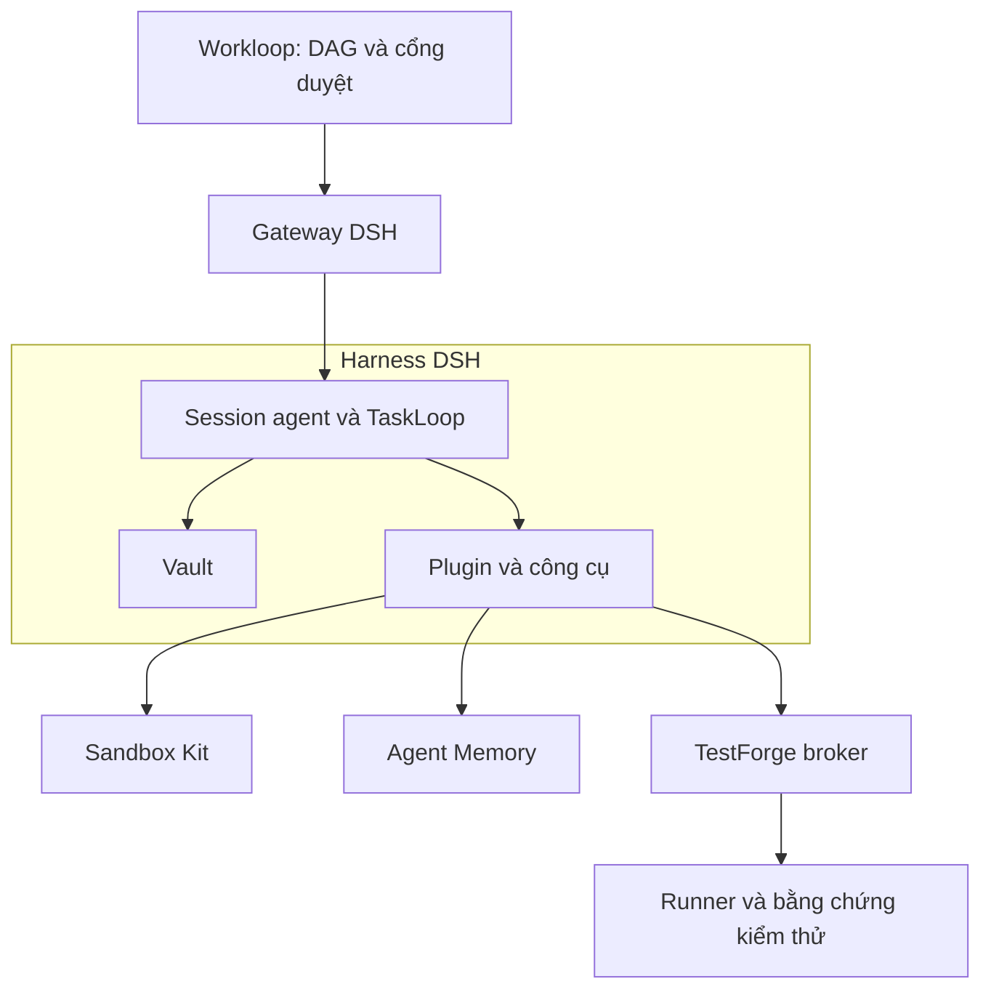

# Tầng 3 · Harness

Harness cung cấp phiên agent, model, công cụ, workspace, TaskLoop và secret. **Workloop điều phối
công việc; Harness thực thi từng task.** Người dùng theo dõi workflow và duyệt tại dashboard
Workloop; quản trị viên dùng giao diện DSH để cấu hình hoặc kiểm tra sâu một phiên.

## Ai chịu trách nhiệm phần nào?

| Thành phần | Trách nhiệm | Kết quả cần theo dõi |
|---|---|---|
| **Workloop** | Nạp spec từ factory, chạy DAG, lưu job/events, tổ chức review và resume | Workloop job ID, SHA của spec, trạng thái node, quyết định duyệt |
| **Gateway DSH** | Chuyển node thành contract và phiên agent; theo dõi tiến độ, timeout và re-arm | Contract ID, session ID, số attempt |
| **Harness** | Chạy model, cung cấp công cụ và workspace, quản lý phiên | Tool call, nội dung phiên, report và mức sử dụng |
| **Plugin** | Đăng ký năng lực cụ thể và kết nối dịch vụ tương ứng | Tham số gọi, mã job dịch vụ, dữ liệu trả về |
| **Sandbox/TestForge/Memory** | Thực thi hoặc lưu trữ trong backend riêng của từng dịch vụ | Artifact, kết quả test, ngữ cảnh có nguồn |

Plugin được nạp trong runtime DSH. Kết nối tới backend phụ thuộc plugin: TestForge dùng HTTP;
Agent Memory dùng MCP; gateway Workloop dùng SDK/RPC của DSH. Không coi tất cả kết nối là một
REST API chung hoặc dùng chung token.

## Các cách tích hợp

| Cách dùng | Bên giữ trạng thái công việc | Phần Harness cung cấp |
|---|---|---|
| Workloop qua gateway DSH | Engine DAG, job và gate Workloop | Session, TaskLoop contract, tool và report |
| ADLC qua execution hub | Coordinator và attempt ledger ADLC | API có bearer, interaction, verifier, artifact và signed outbox |
| ADLC qua native iteration | Task Loop kernel ADLC | Một phiên mới chỉ đề xuất file cho mỗi vòng |

Các đường này có mặt trong source nhưng dùng giao thức và credential riêng. Phần mở rộng
ADLC không tự được kích hoạt trong Workloop khi cài DSH. Cách chọn API nằm ở
[giao diện Harness](/docs/reference/harness-interfaces); capture, proof và recovery nằm ở
[contract và bằng chứng](/docs/architecture/tang-3-harness/contract-va-bang-chung).

## Từ một node Workloop đến một phiên agent

1. Workloop đọc `role`, brief, model và giới hạn thực thi trong spec/factory.
2. Gateway tạo hoặc đối soát contract TaskLoop và gắn phiên vào workspace tương ứng.
3. Agent nhận persona cùng brief, dùng các tool được runtime cấp và ghi report.
4. Gateway quan sát trạng thái contract, lưu session ID và kết quả về node Workloop.
5. Cổng review trong workflow quyết định bước tiếp theo dựa trên report và bằng chứng.

Một workflow có nhiều node; một node có thể có nhiều attempt/session khi phục hồi. Dùng cả
**job ID → node → contract/session ID** để tra cứu. Không đánh đồng dòng trả lời cuối của agent
với kết quả kiểm thử độc lập.

## TaskLoop và phục hồi

Contract thể hiện tiến độ nhiệm vụ:

`PENDING → IN_PROGRESS → DONE | DONE_WITH_CONCERNS | BLOCKED | NEEDS_CONTEXT`.

Với `vai-taskloop`, agent cập nhật file contract qua tool. `DONE` là tín hiệu tiến độ mà
gateway quan sát, chưa thay cho kiểm thử độc lập. SDK cũng dừng chờ ở `BLOCKED` và
`NEEDS_CONTEXT`. Workloop cần đọc kết quả từng node và áp dụng gate riêng;
xem [TaskLoop contract](/docs/user-guides/harness-dsh/taskloop-contract).

Gateway có cơ chế phát hiện stall và re-arm theo ngân sách. Task tạo job từ xa cần lưu job ID
để đối soát trước khi thử lại; mở phiên agent mới không làm job TestForge cũ tự dừng.

## Vault và quyền công cụ

Secret được cấu hình ở host/vault phù hợp, dùng tên ref trong hướng dẫn và brief. Token gọi
Workloop, token DSH và token TestForge là ba loại khác nhau. Secret của Workloop không mặc nhiên
được sao chép sang Settings → Secrets của Harness hoặc môi trường broker.

Persona mô tả cách agent làm việc; quyền dùng tool phải được cấu hình ở runtime. Việc viết
"chỉ đọc" trong brief không thay thế kiểm soát quyền của plugin/backend.

## Hệ sinh thái tích hợp

| Năng lực | Vai trò | Tài liệu |
|---|---|---|
| **Gitea** | Lưu source, spec, persona, PR và phiên bản | [Gitea](/docs/user-guides/cong-cu-ho-tro/gitea) |
| **Sandbox Kit** | Workspace/VFS và môi trường thực thi cô lập | [Sandbox Kit](/docs/user-guides/sandbox-kit/gioi-thieu) |
| **Agent Memory** | Truy xuất ngữ cảnh có nguồn theo phạm vi được cấp | [Cognee](/docs/architecture/tang-3-harness/cognee-agent-memory) |
| **TestForge AI** | Kiểm thử chức năng, hồi quy và hiệu năng; trả bằng chứng | [Kiến trúc TestForge](/docs/architecture/tang-3-harness/testforge-test-agent) |
| **Steel Browser** | Thao tác trình duyệt từ agent | [Steel Browser](/docs/user-guides/cong-cu-ho-tro/steel-browser) |
| **Playwright/k6** | Engine kiểm thử chức năng và tải của runner | [Playwright & k6](/docs/user-guides/cong-cu-ho-tro/playwright-k6) |

TestForge plugin là client tới broker, không tự cài Playwright/k6 hoặc biến mọi job thành job
trong Sandbox Kit. Vị trí runner và môi trường SUT cần xác nhận theo deployment.

## Bắt đầu sử dụng

- [Cài đặt và kết nối Harness](/docs/user-guides/harness-dsh/cai-dat-ket-noi).
- [Vận hành Harness từ Workloop](/docs/user-guides/harness-dsh/van-hanh-workloop).
- [Kiểm tra patch, test và report](/docs/user-guides/harness-dsh/kiem-tra-ket-qua).
- [Phục hồi và xử lý sự cố](/docs/user-guides/harness-dsh/phuc-hoi-va-xu-ly-su-co).
- [Đưa kiểm thử TestForge vào workflow](/docs/user-guides/testforge/tich-hop-workloop).
- [Nạp tri thức dự án vào Agent Memory](/docs/user-guides/agent-memory-cognee/gioi-thieu).

Mở rộng runtime theo contract tại [Viết plugin](/docs/developer-docs/viet-plugin).
