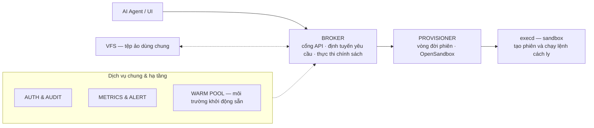

# Tầng 4 · Sandbox — thực thi cô lập & mở rộng ngang

> Sơ đồ gốc nằm trong slide Sandbox Kit — xuất hình vào `static/img/02-architecture/` khi có.



## Thành phần

| Thành phần | Vai trò |
|---|---|
| **Broker** | Nhận lệnh HTTP REST, định tuyến yêu cầu, thực thi chính sách (lệnh · đường dẫn · giới hạn) |
| **VFS** | Virtual File System lưu trữ tệp ảo dùng chung — tệp dự án **sống độc lập với phiên thực thi** |
| **Provisioner** | Quản lý vòng đời sandbox trên OpenSandbox; môi trường chạy trên **nhân ảo (user space)**, hạn chế chạm vào nhân máy chủ |
| **Warm pool** | Nhóm môi trường khởi động sẵn, tránh cold-start khi agent cần chạy ngay |
| **Runners** | Chạy song song hàng chục–hàng trăm agent, không lo nghẽn tài nguyên hay xung đột |

## Ba khác biệt cốt lõi so với giải pháp ngoài

1. **Mã nguồn nằm riêng** — môi trường chỉ bật khi cần; tệp dự án vẫn được lưu khi phiên tắt.
2. **Kiểm soát tập trung** — quản lý phiên, quyền truy cập qua một cổng broker; không cần SSH/VPN.
3. **Thay đổi được duyệt** — thay đổi của agent hiển thị qua giao diện review trước khi gộp.

> Chạy hoàn toàn trên hạ tầng nội bộ — so sánh với E2B/Daytona/OpenHands xem slide Sandbox Kit.

## Luồng E2E của một lệnh

```
Nhận yêu cầu → Kiểm tra chính sách → Thực thi cách ly → Ghi nhận kết quả
(qua Broker)   (lệnh·đường dẫn·      (sandbox riêng,     (trạng thái·
                giới hạn)             user-space kernel)  thời lượng)
```

Plugin **vai-sandbox** trên harness gọi broker qua REST (action chạy lệnh với timeout). Engine
workloop ngoài ra có chế độ `exec-sandbox` — mỗi lần chạy một microVM, lấy từ warm pool.

:::info Hướng dẫn sử dụng
Tạo phiên, xem diff, merge: [HDSD Sandbox Kit](/docs/user-guides/sandbox-kit/gioi-thieu) ·
Chi tiết bảo mật nhiều lớp: [Bảo mật nhiều lớp](/docs/architecture/phan-quyen-bao-mat/bao-mat-nhieu-lop).
:::
