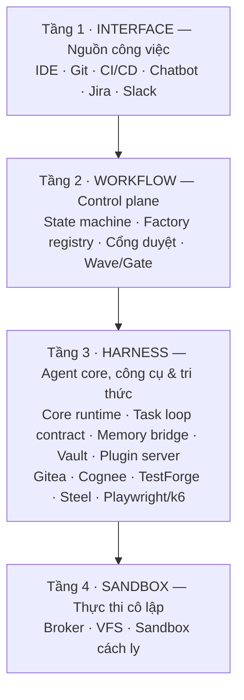

# Kiến trúc tổng thể 4 tầng

> Sơ đồ gốc nằm trong slide ADLC — xuất hình vào `static/img/02-architecture/` khi có.

## Vai trò từng tầng

- **Tầng 1 — Interface:** không ép tổ chức vào một giao diện duy nhất. Công việc khởi tạo ngay
  tại môi trường làm việc tự nhiên của từng vai trò (dev/QA qua IDE & Git; PM/Marketing qua
  chatbot & Jira). Chi tiết: [Tầng 1](/docs/architecture/tang-1-interface).
- **Tầng 2 — Workflow:** quản trị trạng thái & vòng đời task, đăng ký factory cho từng sản phẩm.
  Chi tiết: [Tầng 2](/docs/architecture/tang-2-workflow).
- **Tầng 3 — Harness:** bộ não — agent core, công cụ & tri thức; hệ sinh thái plugin con.
  Chi tiết: [Tầng 3](/docs/architecture/tang-3-harness/tong-quan-harness).
- **Tầng 4 — Sandbox:** thực thi cô lập, mở rộng ngang. Chi tiết:
  [Tầng 4](/docs/architecture/tang-4-sandbox/tong-quan).

## Các tầng nối vào nhau thế nào

Bốn tầng không đứng riêng lẻ — toàn bộ mối nối của hệ thống được mô tả ở nhóm trang sau:

| Mối nối | Trang |
|---|---|
| Một ticket đi xuyên hệ thống từ đầu đến PR | [Luồng hoạt động End-to-End](/docs/architecture/luong-hoat-dong) |
| Kênh giao tiếp + hợp đồng giữa các tầng | [Giao tiếp & Integration Contracts](/docs/architecture/giao-tiep) |
| Dữ liệu mã nguồn, telemetry và artifact trôi qua đâu | [Data Flow & Artifact Flow](/docs/architecture/luong-data/data-ma-nguon) |
| Rào chắn khi các tầng nói chuyện với nhau | [Bảo mật nhiều lớp](/docs/architecture/phan-quyen-bao-mat/bao-mat-nhieu-lop) |
| Khi mối nối gặp gián đoạn | [Kiểm chứng & phục hồi](/docs/architecture/kiem-chung-phuc-hoi/ba-vong-cai-tien) |

:::info Hướng dẫn sử dụng
Muốn chạy thử hệ thống ngay: [Hướng dẫn chạy lần đầu](/docs/user-guides/dung-he-thong-lan-dau).
:::
