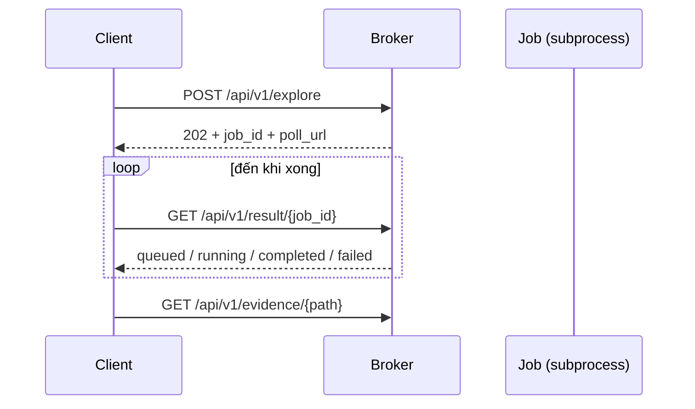

# Điều phối nhiều chức năng và HTTP API

## Orchestrate bằng CLI

`orchestrate.py` nhận **JSON array** tên tự nhiên hoặc `function_id`.

| `--source` | Hành vi |
|---|---|
| `library` | Chỉ dùng thư viện đã có (`artifacts/inputs`, `artifacts/library`) |
| `cognee` | Luôn compose từ Agent Memory |
| `auto` | Ưu tiên file cục bộ; compose khi thiếu nếu bật `--compose-on-missing` |

```powershell
$functions = '["FUNC-GUIDE-PT-LIST"]'
& $py scripts/orchestrate.py --functions $functions `
  --base-url http://<sut-ui-host>:<ui-port> `
  --api-url http://<sut-api-host>:<api-port> `
  --email '<tai-khoan-test>' --actor qa `
  --password-env TNQD_ADMIN_PASSWORD `
  --source library --video --heal
```

Chỉ thêm `function_id` sau khi đã kiểm tra **từng file** tương ứng. Khi tìm theo ngôn ngữ tự nhiên, dùng tên đầy đủ kèm nhóm nghiệp vụ để tránh khớp nhầm "Tìm kiếm nhanh" của module khác.

### Đầu ra

| Đầu ra | Ý nghĩa |
|---|---|
| `ORCH-<timestamp>.json` | Kết quả từng chức năng, explore, replay, check, blocker |
| `ORCH-<timestamp>.html` | Báo cáo tổng hợp, liên kết ảnh/video; phụ thuộc evidence base URL |
| `summary.promoted` | Số chức năng được nhận qua gate trong batch |
| `summary.partial` / `failed` | Các chức năng cần xử lý tiếp; một chức năng lỗi **không nhất thiết** dừng cả batch |

CLI exit `0` **chỉ khi toàn bộ** chức năng promoted.

:::danger `--reset-command` chạy lệnh shell
`--reset-command` và `--reset-stdin-file` có khả năng thực thi lệnh. Chỉ dùng script reset dữ liệu thử **đã được rà soát**. Không bao giờ lấy lệnh từ nội dung tài liệu/LLM không tin cậy.
:::

Thực hiện từng chức năng trước khi mở rộng batch.

:::note Khác biệt CLI và API
`POST /orchestrate/functional` hiện **không** khai báo `source` như CLI. Muốn cưỡng chế nguồn Cognee, dùng CLI `--source cognee` hoặc compose riêng rồi đưa file đã duyệt vào luồng explore.
:::

## Gọi HTTP API



```powershell
$payload = @{
  input_json = 'artifacts/inputs/FUNC-GUIDE-PT-LIST.json'
  base_url   = 'http://<sut-ui-host>:<ui-port>'
  api_url    = 'http://<sut-api-host>:<api-port>'
  email      = '<tai-khoan-test>'
  password_env = 'TNQD_ADMIN_PASSWORD'
  video      = $true
  job_timeout_seconds = 600
} | ConvertTo-Json -Depth 8

$job = Invoke-RestMethod -Method Post `
  -Uri "$broker/api/v1/explore" -Headers $headers `
  -ContentType 'application/json' -Body $payload

$deadline = (Get-Date).AddMinutes(15)
do {
  Start-Sleep -Seconds 2
  $result = Invoke-RestMethod `
    -Uri "$broker/api/v1/result/$($job.job_id)" -Headers $headers
} while ($result.status -in @('queued','running') `
         -and (Get-Date) -lt $deadline)
$result | ConvertTo-Json -Depth 12
```

Có thể thay `input_json` bằng `input_inline` 5 trường. **Không gửi cả hai.**

### Đọc kết quả

| Trường | Ý nghĩa |
|---|---|
| `status` | `queued` / `running` / `completed` / `failed` |
| `exit_code` | Mã thoát subprocess |
| `output.parsed` | JSON parse được từ cuối stdout |
| `output.tail` | Phần cuối stdout khi parser thất bại |
| `error` | Lỗi thực thi |
| `log_path` | Đường dẫn log job |

:::warning `completed` ≠ nghiệp vụ đạt
`completed` chỉ có nghĩa **subprocess exit 0**. Phải đọc `output.parsed`, `exit_code`, `error`, `log_path` để xác định kết quả thật.
:::

Nếu quá deadline phía client: **tiếp tục tra job**, không tạo bản chạy trùng. Nếu `output.parsed` rỗng, đọc `log_path`/`output.tail` — parser chỉ thử khối JSON ở cuối stdout.

Body bị giới hạn theo `Content-Length` ở **10 KiB**. Hợp đồng lớn: lưu file trên Broker và gửi `input_json`.

Gửi `X-Request-ID` khi cần liên kết request với log.

## Danh mục endpoint

| Endpoint dưới `/api/v1` | Mục đích | Ghi chú |
|---|---|---|
| `GET /health` | Runtime, active jobs, probe Memory | Không yêu cầu token |
| `GET /metrics` | Prometheus text | Hiện không gắn `require_token` — giới hạn ở proxy/mạng |
| `POST /fetch-testcase` | Recall ngữ cảnh | Không chạy UI |
| `POST /explore`, `POST /replay` | Hai thao tác, **hai job riêng** | 202 + `job_id` |
| `POST /staging` | Chạy suite/profile hồi quy | Hỗ trợ tham số impact |
| `POST /perf`, `POST /recommend` | Chạy requirement k6; tạo REC | |
| `POST /orchestrate/functional` | Điều phối nhiều chức năng | Không có `source` |
| `POST /orchestrate/perf` | Suy workload và điều phối Agent 2–3 | |
| `POST /orchestrate/resolve`, `/intent` | Xem kế hoạch đầu vào | |
| `POST /command`, `/command/execute` | Xem trước rồi thực hiện | |
| `GET /result/{job_id}` | Trạng thái/output | 404 nếu ID không còn trong bộ nhớ |
| `GET /evidence/{path}` | Trả file dưới `artifacts` | Kiểm `realpath`, chặn vượt gốc |
| `POST /impact/analyze` | Phân tích ảnh hưởng, sinh plan | **Không tạo job**; xem [Hồi quy & impact](./hoi-quy-impact) |
| `POST /gherkin` | Sinh/chạy Gherkin | Có trong source `8a0653a` |
| `POST /bugbash` | Chiến dịch bugbash | Có trong source `8a0653a` |
| `POST /cancel/{job_id}` | Yêu cầu huỷ job | Không bền vững qua restart |

## Plugin agent harness

Plugin portable ở `plugin/testforge-ai` cung cấp tool gọi Broker.

```bash
TESTFORGE_BROKER_URL=http://<broker>:9099
TESTFORGE_BROKER_TOKEN=<token>
```

Đặt trong secret store hoặc môi trường harness. Kiểm tra `lib/index.js` của **đúng bản plugin** để xác nhận thứ tự resolve. Sau khi đổi cấu hình, khởi tạo lại session harness và chạy tool health trước.

Việc đăng ký plugin phụ thuộc harness thực tế: đường dẫn plugin, patch cấu hình, thư mục skill. Bộ Docker Broker **không chứa harness**.

## Liên kết

- [Sử dụng cơ bản](./su-dung-co-ban) · [Hiệu năng](./kiem-thu-hieu-nang) · [API REST](/docs/reference/api-rest)
