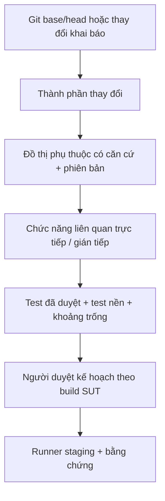

# Hồi quy và phân tích ảnh hưởng

## Chạy staging suite

```powershell
& $py scripts/run_staging.py `
  --profile opt/staging/<profile-da-duyet>.json `
  --suite opt/staging/<suite-da-duyet>.json --keep-runs 20
```

Tạo suite/profile theo `schemas/staging_profile.schema.json`, `schemas/staging_suite.schema.json` và cấu trúc `src/agent1/staging.py` dùng.

Kiểm tra trước khi chạy: tài khoản, đường dẫn spec, dữ liệu, preflight môi trường.

:::warning[File generated chỉ là bản nháp]
Các file trong `opt/staging/generated` là đầu ra sinh hoặc bản nháp. Phải được **duyệt** trước khi dùng làm bộ hồi quy chính thức.
:::

## Phân tích ảnh hưởng là gì?

Khi SUT thay đổi, câu hỏi không phải "chức năng đó còn đúng không" mà là **"những chức năng dùng chung dữ liệu/màn hình/xử lý có bị ảnh hưởng không"**.

Impact trả lời câu đó **trong phạm vi đã ánh xạ**:



Mỗi cạnh đi từ **bên sử dụng → thành phần được sử dụng**. Ví dụ: chức năng → API, API → file xử lý, API → dữ liệu (reads/writes).

:::note[Điểm quan trọng về dữ liệu]
Khi một **writer** thay đổi, hệ thống truy tới dữ liệu nó ghi rồi tìm các bên đọc/ghi liên quan — thay vì chỉ chọn test có tên giống nhau.
:::

### Impact **không** làm gì

| Không làm | Hệ quả |
|---|---|
| Không trích xuất toàn bộ call graph mọi ngôn ngữ | Phụ thuộc ngoài mapping có thể bị bỏ sót |
| Không đọc hiểu migration / OpenAPI diff | Thay đổi schema cần người đánh giá |
| Không dùng LLM phát hiện phụ thuộc mới | Không có "tự động thông minh" ngoài mapping |
| Không chứng minh hệ thống không bị ảnh hưởng | PASS chỉ nghĩa các test đã chọn đạt |
| Không thay reviewer | `approved_by` là audit, chưa phải chữ ký số |

## Chuẩn bị mapping

1. Chọn **3–5 chức năng** đã có testcase staging và oracle đúng.
2. Tạo config theo `schemas/impact_config.schema.json`: SUT ID/build, graph revision, scope, nodes, edges, test registry.
3. `scope.complete` chỉ đặt `true` khi mapping **đủ** trong phạm vi mô tả; mặc định thí điểm phải `false`.
4. Gắn file **của SUT** với node qua `paths` — đường dẫn tương đối chính xác, **không dùng glob**.
5. Giữ mapping của cả thành phần cũ khi có rename/delete.
6. Mỗi quan hệ cần `evidence`: source file/symbol tại commit, đoạn tài liệu, trace theo test ID hoặc biên bản review.
7. Ánh xạ test → function ID. Duyệt toàn bộ case: steps, dữ liệu, oracle, fixture, cleanup, rules.
8. `case_sha256` = `src.impact.engine.digest(case)`; `approved_by` chỉ ghi **sau khi duyệt thật**.
9. Đặt `baseline: true` cho bài bắt buộc: đăng nhập, quyền, dữ liệu chung.

:::danger[`observed` / `suggested` / `stale` không đủ để thu hẹp tự động]
Hệ thống sẽ **mở rộng toàn bộ phạm vi** và yêu cầu review. Không dùng các trạng thái này để tự động bỏ test.
:::

`opt/impact/example/` là **dữ liệu tổng hợp**, không phải mapping của một hệ thống thật đã xác minh. Profile trỏ `localhost`, không dùng để chạy lên SUT thật.

## Tạo kế hoạch

```powershell
python scripts/analyze_impact.py `
  --config opt/impact/example/config.json `
  --suite opt/impact/example/suite.json `
  --profile opt/impact/example/profile.json `
  --changed-file app/write.py --target-revision build-2 `
  --output artifacts/impact/example/impact_plan.json
```

Hoặc dùng Git:

```text
--repo <repo-cua-SUT> --base <base-SHA> --head <head-SHA>
```

Ngoài ra có thể truyền `--function FUNC-...`, `--component <node-id>`, nhiều `--changed-file`.

| Lưu ý | Chi tiết |
|---|---|
| Git mode | Chỉ đọc thay đổi **đã commit**; không checkout, không chạy code/hook của SUT; **không** gồm sửa đổi chưa commit |
| Repo | Phải là repo **SUT**, không dùng diff TestForge để kết luận ảnh hưởng ứng dụng khác |
| Khi chỉ có mã chức năng | Hệ thống xem các touchpoint đã ánh xạ là nơi có thể thay đổi — lựa chọn **bảo thủ**, không xác định chính xác dòng code |

### Đọc kế hoạch

| Trường | Ý nghĩa |
|---|---|
| `affected_functions` | Chức năng bị ảnh hưởng + đường giải thích từng quan hệ |
| `selected_tests` | Test được chọn, hash nội dung, nguồn mapping, trạng thái baseline |
| `coverage_gaps` | Phần chưa có test hoặc test mất hiệu lực duyệt |
| `test_result` | Luôn `NOT_RUN` — phân tích **không** chạy test |

## Trạng thái chính sách

| Trạng thái | Hành vi |
|---|---|
| `READY` | Có test cho chức năng liên quan theo mapping + baseline; **vẫn cần reviewer** để chạy |
| `REVIEW_REQUIRED` | Thay đổi chưa ánh xạ, graph khác build, cạnh chưa xác minh, scope chưa đầy đủ hoặc thay đổi global → mở rộng toàn bộ phạm vi mapping, cần review |
| `BLOCKED` | Thiếu test/approval, case đổi sau duyệt, case không còn trong suite hoặc lựa chọn rỗng → **không chạy** dù nhập reviewer |

"Mở rộng toàn bộ" chỉ là toàn bộ **phạm vi registry**, không phải tự suy ra mọi chức năng ngoài catalog. Phạm vi thiếu phải còn hiển thị **sau khi chạy**.

## Từ kế hoạch đến thực thi

```powershell
python scripts/run_staging.py `
  --profile <profile.json> `
  --suite <full-reviewed-suite.json> `
  --impact-config <config.json> `
  --impact-plan <impact_plan.json> `
  --target-revision <deployed-build> `
  --impact-approved-by <reviewer> `
  --output artifacts/automation/staging
```

Runner **tái tính** toàn bộ kế hoạch từ đầu vào và kiểm tra build trước preflight. Các trường hợp sau **dừng trước khi gọi SUT**:

- thiếu tham số;
- sửa plan;
- đổi test/oracle/profile;
- đổi build;
- có coverage gap.

Test được chọn giữ nguyên **thứ tự và nội dung**, gồm rules đã duyệt. Lệnh staging cũ không có cờ impact vẫn hoạt động như trước.

:::warning[`target_revision` là lời khai của caller]
Hiện chưa có bộ đọc build từ endpoint triển khai để xác thực độc lập. Khi tích hợp CI phải lấy từ **deployment metadata**, không nhập SHA bất kỳ để khớp kế hoạch.
:::

Sau khi chạy, cùng thư mục STAGING có:

```text
impact_plan.json
selected_suite.json
impact_result.json
summary / JUnit
evidence của runner
```

## Gọi qua API

`POST /api/v1/impact/analyze` dùng Bearer auth hiện có; nhận `config`, `suite`, `profile` là **path server**, cùng `functions`, `components`, `files`, `target_revision` — hoặc `repo`, `base`, `head`.

Trả plan và `plan_path` tại `artifacts/impact/IMPACT-<hash>/impact_plan.json`. **Phân tích không tạo job.**

Sau khi review, gọi `POST /api/v1/staging` như trước và thêm:

```json
{
  "impact_config": "...",
  "impact_plan": "...",
  "target_revision": "...",
  "impact_approved_by": "..."
}
```

Runner kiểm tra lại toàn bộ đầu vào khi job thực thi — tránh dùng kế hoạch cũ khi đang xếp hàng.

## Cách nghiệm thu nghiệp vụ

Để chứng minh giá trị (chưa làm thì **chưa công bố % tiết kiệm**):

1. Tạo các thay đổi **cài lỗi trực tiếp và gián tiếp**.
2. So bộ test được chọn với **toàn bộ suite đã duyệt** trên cùng build/dữ liệu.
3. Đếm số test phát hiện lỗi bị bỏ sót.
4. Đo **phút người** rà ảnh hưởng + chọn test.
5. Đo thời gian thực thi.

## Giới hạn cần nói rõ

- PASS chỉ nghĩa **các test đã chọn** đạt, không phải toàn hệ thống không bị ảnh hưởng.
- Phân tích trên **phạm vi đã ánh xạ**; mapping sai thì kết luận sai.
- Chưa tự trích xuất call graph đa ngôn ngữ, chưa đọc migration/OpenAPI diff.
- `approved_by` chưa phải workflow phân quyền QA.

## Liên kết

- [Kiểm thử hiệu năng](./kiem-thu-hieu-nang) · [Vận hành](./van-hanh-su-co) · [Known issues](/docs/reference/known-issues)
