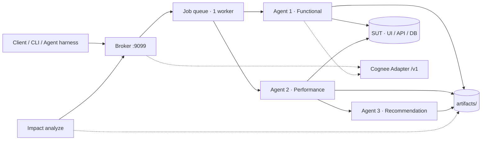
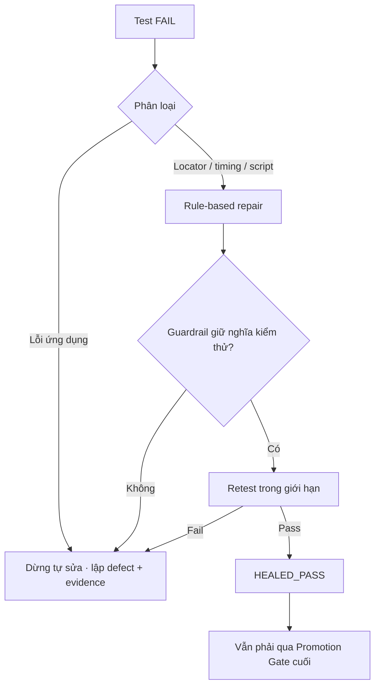

# Kiến trúc TestForge AI

:::note[Thông tin trang]
| | |
|---|---|
| **Hệ thống** | TestForge AI |
| **Phạm vi** | Broker, Agent 1–3, schema, artifact |
| **Phiên bản tài liệu** | 1.0 — dựng từ bản phát hành TestForge đã được duyệt |
| **Cập nhật** | 2026-11-13 |

Bản phát hành hiện tại có thêm module **impact** (`scripts/analyze_impact.py`, `src/impact/`) — chưa có trong tài liệu thiết kế v1.0. Xem [Hồi quy và phân tích ảnh hưởng](./hoi-quy-impact).

:::

TestForge là chuỗi công cụ biến **yêu cầu nghiệp vụ** thành **bằng chứng kiểm thử**:

1. Chuẩn hóa yêu cầu thành Standard Test Input 5 trường.
2. Khám phá giao diện thật, ghi trace, sinh script Playwright.
3. Replay, kiểm chứng và chấm qua Promotion Gate.
4. Đo tải bằng k6 và tạo khuyến nghị khi ngưỡng bị vi phạm.
5. Chọn phạm vi hồi quy có căn cứ từ thay đổi của SUT (impact).

**Broker là lớp HTTP điều phối**, không phải nơi chứa logic kiểm thử. Mỗi job chạy trong tiến trình con và ghi artifact xuống đĩa.

## Thành phần

| Thành phần | Vị trí | Trách nhiệm |
|---|---|---|
| Broker | `testforge_broker.py` | HTTP API, xác thực, hàng đợi job, health, metrics, phân phối evidence |
| Agent 1 | `src/agent1/` | Chuẩn hóa, khám phá UI, sinh Playwright, replay, verification, healing, Promotion Gate |
| Agent 2 | `src/agent2/` | Phân giải requirement, sinh script k6, tổng hợp NDJSON, đối chiếu ngưỡng |
| Agent 3 | `src/agent3/` | Phân tích chỉ số vi phạm, sinh evidence, giả thuyết, kế hoạch xác minh |
| Điều phối | `scripts/orchestrate*.py` | Phân giải chức năng, gọi các bước, tổng hợp báo cáo JSON/HTML |
| Impact | `scripts/analyze_impact.py`, `src/impact/` | Truy vết phụ thuộc, chọn test hồi quy, xuất kế hoạch có giải thích |
| Hợp đồng | `schemas/` | Schema đầu vào, kết quả và artifact |
| Cấu hình | `opt/` | Profile tải, requirement, dữ liệu mẫu, cấu hình môi trường |
| Bằng chứng | `artifacts/` | Input, trace, script, ảnh/video, log, kết quả, báo cáo |
| Tích hợp | `cognee_adapter.py`, `plugin/` | Chuẩn hóa API Cognee; tool cho agent harness |
| Quan sát | `src/observability/` | Log JSON, request context, thông tin chẩn đoán |



## Luồng dữ liệu chức năng

```text
Phân giải chức năng
  → chọn file thư viện hoặc compose từ Cognee
  → kiểm tra hợp đồng 5 trường
  → explore UI + ghi trace
  → sinh script Playwright
  → đăng nhập lại và replay
  → verification
  → Promotion Gate
```

Tên chức năng chỉ giúp **tìm** đầu vào. `function_id`, nội dung hợp đồng và evidence mới là căn cứ truy vết.

### Mã định danh cần giữ

| Mã | Ý nghĩa |
|---|---|
| `function_id` | Định danh yêu cầu/testcase; giữ ổn định để tra thư viện và đối chiếu phiên bản |
| `JOB` | Tác vụ HTTP của Broker: trạng thái, `exit_code`, đường dẫn log |
| `ORCH` | Báo cáo điều phối nhiều chức năng hoặc nhiều endpoint |
| `EXPLORE` | Phiên khám phá: `trace.jsonl`, summary, ảnh/video, thư mục synthesis |
| `PRUN` | Lượt chạy tải: requirement, script k6, NDJSON, kết quả hiệu năng |
| `REC` | Khuyến nghị sinh từ PRUN vi phạm ngưỡng |
| `IMPACT` | Kế hoạch hồi quy từ phân tích ảnh hưởng |

## Promotion Gate

Gate là **hợp đồng chất lượng**: một bài test chỉ được vào bộ chuẩn khi mọi check áp dụng đều đạt.

| Check | Câu hỏi mà check trả lời |
|---|---|
| `step_coverage` | Bài test có đi hết luồng, hay bỏ dở giữa đường? |
| `oracle_from_contract` | Bước "Then" có được grounding thành assertion không? |
| `static_validation` | Script có lỗi tĩnh, locator chết hoặc cấu trúc sai không? |
| `replay_pass` | Chạy lại có đạt, hay chỉ đúng một lần may mắn? |
| `verification_engine` | Các kiểm tra độc lập có đạt? |
| `cleanup_resolved` | Tài nguyên phát sinh đã được xử lý? |
| `provenance_complete` | Có đủ dấu vết nguồn và phiên bản? |
| `standard_input_contract` | Đầu vào đúng 5 trường? |
| `video_evidence` | Chỉ thêm khi bật video |
| `api_state` | Chỉ thêm khi có dữ liệu phát sinh cần xác minh |

:::warning[Số check không cố định]
Số check thay đổi theo lượt chạy (video, owned resource, API state). Không dùng câu "luôn có 9 check" trong báo cáo.
:::

**Ví dụ minh hoạ:** 4 check PASS nhưng `step_coverage` chỉ đạt 20/29 bước và `oracle_from_contract` 0/2 → tổng thể `PARTIAL`, không luồng nào được promote. Đây là hành vi đúng: chạy được **không** đồng nghĩa kiểm chứng được.

## Tự phục hồi và ranh giới



- Lỗi ứng dụng **phải dừng** tự sửa.
- Bản sửa chỉ được đổi **cách thao tác**, không được đổi **kết quả mong đợi**.
- `HEALED_PASS` không tự thay thế điều kiện promote cuối cùng.

## Ranh giới của kiến trúc

| Điều TestForge làm | Điều TestForge không làm |
|---|---|
| Sinh test từ tài liệu và UI thật | Không sửa mã nghiệp vụ của SUT |
| Chạy, replay, thu bằng chứng | Không khẳng định nguyên nhân gốc khi chưa có log |
| Chấm gate và chặn test kém | Không thay quyết định phạm vi của con người |
| Chọn test hồi quy theo mapping | Không tự suy ra toàn bộ call graph của mọi ngôn ngữ |
| Đo tải bằng k6 | Không thay SLA hay năng lực hạ tầng production |

## Liên kết

- [Kiểm chứng độc lập](/docs/architecture/kiem-chung-phuc-hoi/kiem-chung-doc-lap)
- [TestForge trong tầng Harness](/docs/architecture/tang-3-harness/testforge-test-agent)
- [Cài đặt](./cai-dat) · [Cấu hình](./cau-hinh) · [Sử dụng](./su-dung-co-ban)
