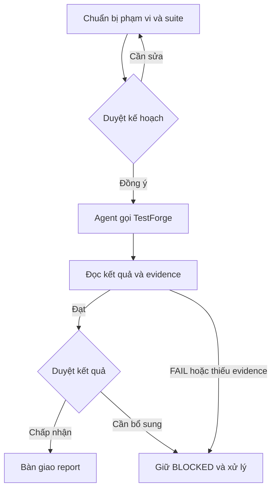

import useBaseUrl from '@docusaurus/useBaseUrl';

# Tích hợp TestForge vào Workloop

Mục tiêu: chạy suite TestForge đã duyệt từ một workflow, đọc kết quả ở **Runs** và duyệt trên
**Workloop → Duyệt**. TestForge được gọi bởi agent qua plugin trên Harness; dùng node
`WorkloopTask` hiện có, không thêm một node type TestForge giả định.

:::note[Workflow mẫu để nghiệm thu]

Mẫu dưới đây được viết theo loader/spec Workloop tham chiếu, chưa được cài vào factory hoặc
chạy E2E trên môi trường hiện tại. Cần cấu hình staging, suite/profile, quyền tool và thực hiện
các bước nghiệm thu ở cuối trang trước khi dùng làm quy trình chính thức.

:::

## Luồng công việc



Sơ đồ mô tả quy trình người dùng. Mẫu YAML là ba task nối tiếp với `need_review: human`;
không cấu hình cạnh fix-loop tự động. Khi bị yêu cầu sửa, người vận hành xử lý theo cơ chế
review/resume của deployment và giữ lịch sử lượt cũ.

## 1 · Chuẩn bị factory và môi trường

1. [Kết nối Harness với Workloop](/docs/user-guides/harness-dsh/cai-dat-ket-noi) đã qua smoke test.
2. [Plugin TestForge](/docs/user-guides/testforge/cai-dat-ket-noi) được nạp trong đúng runtime.
3. QA/admin chuẩn bị suite và profile JSON thật **trên broker host**, chốt revision/digest,
   cấu hình tài khoản SUT và kiểm tra runner không tự heal bộ test chuẩn.
4. Cấp workspace riêng cho lần nghiệm thu; không chạy nhiều bản mẫu song song trong cùng
   workspace với cùng các tệp report/ledger.
5. Chuẩn bị `qa/testforge-plan.json` trong workspace Harness. Đây là manifest giao việc của
   mẫu, không phải schema request của broker.

Manifest cần các thông tin sau:

| Trường | Nội dung |
|---|---|
| `request_key` | Mã riêng của lần kiểm thử; giữ nguyên khi đối soát lượt cũ |
| `target_url`, `sut_revision` | SUT và build/commit đã được QA/admin xác nhận |
| `profile_path`, `suite_path` | Đường dẫn file JSON có thật trên broker |
| `profile_sha256`, `suite_sha256` | Digest do QA/admin chốt cho revision được duyệt |
| `expected_checks` | Case/tiêu chí bắt buộc và chính sách với FAIL/SKIP |
| `data_scope` | Fixture, quyền ghi/xóa và cách phục hồi dữ liệu đã duyệt |
| `job_timeout_seconds` | Trần thời gian broker, trong giới hạn 30–1200 giây |

Manifest không tự upload file hoặc kiểm tra digest trên broker. Admin cần bảo đảm file được
chạy đúng revision; nếu deployment chưa trả digest/attestation, ghi rõ đây là đối chiếu thủ
công, chưa phải Verify receipt có ràng buộc mật mã.

## 2 · Thêm spec và persona theo quy trình PR

Tải các tệp mẫu rồi đặt vào factory:

| Tệp mẫu | Vị trí trong factory |
|---|---|
| [testforge-regression.spec.yaml](/examples/testforge-regression.spec.yaml) | `workflows/testforge-regression.spec.yaml` |
| <a href={useBaseUrl('/examples/testforge-qa.md')} download>testforge-qa.md</a> | `agents/testforge-qa.md` |
| <a href={useBaseUrl('/examples/testforge-reviewer.md')} download>testforge-reviewer.md</a> | `agents/testforge-reviewer.md` |

Spec có ba task:

```yaml
id: testforge-regression
description: Hoi quy TestForge tren staging, duyet pham vi va bang chung.

tasks:
  - id: prepare_test
    type: WorkloopTask
    role: testforge-qa
    need_review: human
    gate: true
    timeout_s: 180
    stall_s: 120
    max_rearms: 0
    brief: |
      Doc qa/testforge-plan.json, goi health va ghi reports/prepare_test.md.
      Chua tao job kiem thu. Thieu dau vao: NEEDS_CONTEXT.

  - id: run_testforge
    type: WorkloopTask
    role: testforge-qa
    gate: true
    timeout_s: 1500
    stall_s: 1200
    max_rearms: 0
    brief: |
      Dung plan da duyet. Doi soat reports/testforge-job.json truoc.
      Ghi intent, goi testforge_staging mot lan va luu job_id ngay.
      Poll bang testforge_result; doc evidence; ghi reports/run_testforge.md.
      FAIL/PARTIAL/thieu evidence: BLOCKED. Chi DONE khi du va dat.

  - id: review_result
    type: WorkloopTask
    role: testforge-reviewer
    need_review: human
    gate: true
    timeout_s: 300
    stall_s: 180
    max_rearms: 0
    brief: |
      Doi chieu plan, report QA va evidence dung job.
      Ghi reports/review_result.md de nguoi dung duyet.
      Khong tao job moi hoac thay doi test/source.
```

Đoạn trên là bản rút gọn để đọc; tệp tải về chứa brief đầy đủ về intent, đối soát và bằng chứng.
Giữ các ràng buộc này khi sửa mẫu. Chọn provider/model của factory đã duyệt; mẫu không ghi đè
provider hoặc tự chọn model mới.

Persona mô tả hành vi. Admin phải cấp quyền runtime tương ứng: QA được tạo job theo phạm vi;
reviewer chỉ đọc trạng thái/evidence. Hai phiên agent riêng không tự tạo ra verifier tất định
hoặc cơ chế phân quyền backend.

`max_rearms: 0` giúp tránh re-arm task tạo job ngoài ý muốn. Nó không tắt retry HTTP bên trong
plugin và không bảo đảm exactly-once. Ledger giúp đối soát, không thay idempotency phía broker.

## 3 · Sync rồi chạy từ Workloop

Đưa thay đổi qua PR của factory, duyệt và sync theo
[Vòng 4 bước](/docs/user-guides/workloop-dieu-phoi/vong-4-buoc). Kiểm tra workflow xuất hiện trong
**Factory**, mở **Workloop** để thấy ba task và đúng SHA.

Qua MCP, yêu cầu chạy workflow đã được nạp:

```text
Chạy workflow testforge-regression đã có, fresh=true, rồi trả Workloop job_id.
Theo dõi get_run và get_report. Khi chờ phê duyệt, dừng để tôi xử lý trên tab Duyệt.
```

1. `prepare_test` kiểm tra đầu vào và health, chưa chạy suite. Đọc report rồi duyệt phạm vi.
2. `run_testforge` gửi suite/profile đã chốt, lưu mã job và đọc kết quả.
3. `review_result` đối chiếu bằng chứng; kết quả đủ điều kiện mới đi tới duyệt bàn giao.

Nếu node QA `BLOCKED`, đọc report tại **Runs** để xử lý. Cổng duyệt cuối có thể chưa được tạo
vì task trước chưa đạt. Không đổi thủ công node sang DONE để bỏ qua thất bại.

## 4 · Đọc report và truy ngược bằng chứng

| Cấp | Định danh | Nơi đối soát |
|---|---|---|
| Workflow | Workloop job ID và SHA | Runs, `get_run`, `get_report` |
| Task agent | Node ID, contract/session ID, attempt | Report/sự kiện Workloop, phiên DSH tương ứng |
| Test | TestForge job ID và `request_key` | `reports/testforge-job.json`, `testforge_result` |
| Artifact | Đường dẫn report/log/ảnh/JUnit thực tế | `testforge_evidence` hoặc kho báo cáo được cấp quyền |

Mẫu không tạo một tab TestForge mới trên dashboard. Report node là điểm nối giữa Workloop và
kết quả broker; artifact vẫn ở kho của dịch vụ theo chính sách lưu trữ. Nếu muốn tự hiển thị
từng testcase thành một panel, cần phát triển adapter/UI riêng và nghiệm thu sau.

## 5 · Kết quả đúng phải thấy

Khi nghiệm thu trên staging, đối chiếu:

- [ ] Duyệt preflight xong mới có yêu cầu tạo job TestForge.
- [ ] Một suite nhỏ chạy được; report có đúng ID, target/revision và suite/profile.
- [ ] Một case cố ý FAIL được giữ FAIL; QA node không cho qua như một lượt đạt.
- [ ] Ảnh/log/JUnit bắt buộc đọc được và thuộc cùng job.
- [ ] Khi mất phản hồi, đối soát job cũ trước khi tạo job mới.
- [ ] Người duyệt cuối có đủ report và evidence để chấp nhận hoặc yêu cầu xử lý tiếp.

Ghi lại phiên bản Workloop, Harness, plugin và broker cùng bằng chứng sau nghiệm thu. Trước đó,
giữ trạng thái **workflow mẫu/chờ kiểm chứng** trong tài liệu vận hành của nhóm.
