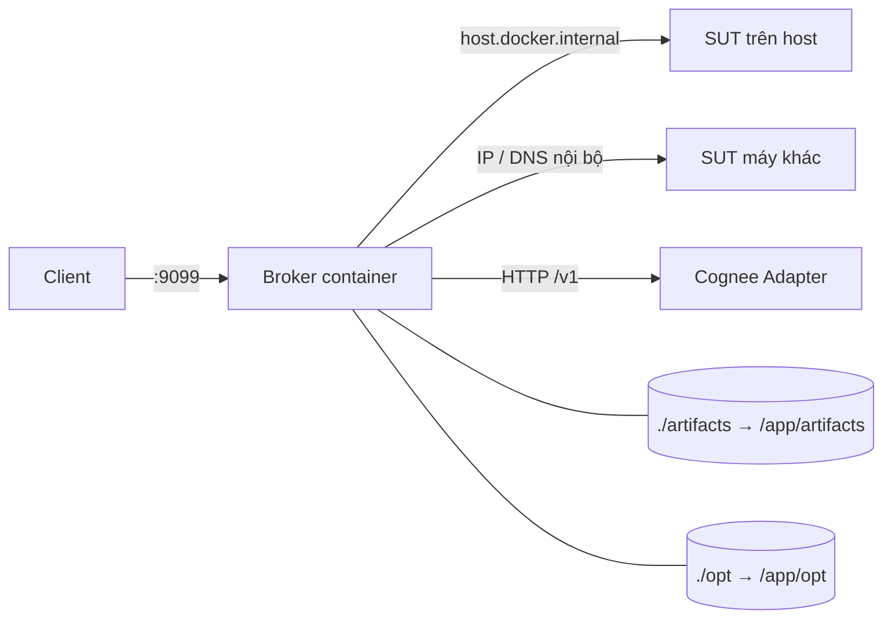

# Triển khai bằng Docker

Compose hiện tại chỉ dựng **Broker**. Không tự dựng SUT, Cognee hay sandbox.

:::note Thực tế file compose
`docker-compose.yml` build từ `docker/Dockerfile.broker-upgrade`, đặt tên image theo biến `TESTFORGE_SOURCE_REVISION`, mở cổng `9099`, gắn `./artifacts` và `./opt`, thêm `host.docker.internal:host-gateway`.
:::

## 1. Chuẩn bị gói

Cần: mã nguồn, `Dockerfile` (hoặc `docker/Dockerfile.broker-upgrade`), `requirements`, `schemas/`, `scripts/`, `src/`, `opt/ptyc_sections.json`, `package.json` + `package-lock.json`.

Giữ nguyên package/version của **release được duyệt**.

## 2. Tạo `opt/broker.env`

Xem danh sách biến đầy đủ ở [Cấu hình](./cau-hinh). Tối thiểu:

```bash
TESTFORGE_BROKER_TOKEN=REPLACE_WITH_BROKER_TOKEN
AGENT_MEMORY_API_URL=http://10.0.10.195:8002/v1
AGENT_MEMORY_API_KEY=REPLACE_WITH_ADAPTER_TOKEN
TESTFORGE_EVIDENCE_BASE_URL=http://10.0.10.195:9099
TESTFORGE_JOB_TIMEOUT=600
TESTFORGE_SOURCE_REVISION=REPLACE_WITH_BUILD_REVISION
TNQD_ADMIN_PASSWORD=REPLACE_WITH_TEST_PASSWORD
LOG_LEVEL=INFO
LOG_JSON=true
```

:::warning `TESTFORGE_SOURCE_REVISION` là bắt buộc
Compose dùng biến này làm tag image (`testforge-broker:${TESTFORGE_SOURCE_REVISION}`) và sẽ dừng nếu thiếu. Lấy giá trị từ `BUILD_REVISION` của bản phát hành.
:::

## 3. Build và chạy

Kiểm tra cổng 9099 không xung đột trước khi tạo container.

```bash
docker compose build broker
docker compose up -d broker
docker compose ps
docker compose logs --tail 100 broker
```

Hoặc dùng trực tiếp env file:

```bash
docker compose --env-file opt/broker.env up -d broker
```

## 4. Mạng container



- `localhost` **trong container** là chính container đó.
- SUT trên host: dùng `host.docker.internal` (đã khai báo `extra_hosts`).
- SUT trên máy khác: dùng IP/DNS mà container truy cập được.
- Volume `./artifacts` và `./opt` giữ dữ liệu **ngoài vòng đời container**.

## 5. Nghiệm thu

| STT | Thực hiện | Điều kiện chấp nhận |
|---|---|---|
| 1 | Đọc health từ máy gọi và từ mạng triển khai | `status=ok`; `interpreter`/`project_root` đúng; `auth_required` đúng cấu hình |
| 2 | Kiểm tra volume và quyền ghi bằng job thử | Log và artifact xuất hiện tại thư mục host đã chọn |
| 3 | Gọi `fetch-testcase` có xác thực | Dataset phân giải được; chunk có tài liệu, chức năng, nội dung phù hợp |
| 4 | Chạy chức năng **đọc** đã duyệt | Explorer có summary và trace; không ghi dữ liệu ngoài phạm vi |
| 5 | Replay session, xem `promotion.json` | Check phản ánh đúng coverage, assertion, bằng chứng; mọi blocker được giải thích |
| 6 | Kiểm tra Agent 2 khi đã triển khai | k6 thấy trong `PATH`; request đơn đúng trước khi tăng tải; lưu threshold thực tế |
| 7 | Đọc metrics và log | Có `request_id`, `job_id`; client truy xuất được evidence theo quyền |

## 6. Cập nhật phiên bản

1. Ngừng nhận job mới; chờ `jobs_active` về 0.
2. Sao lưu cấu hình, thư viện và artifact cần giữ.
3. Lưu **image ID/digest cũ** cùng bản compose.
4. Build/nạp image mới với tag riêng; chạy thử trên môi trường/cổng thử nếu có.
5. Nghiệm thu đủ 7 bước rồi mới chuyển client sang bản mới.

## 7. Quay lui

Trỏ compose về image đã lưu và tạo lại dịch vụ. Với image cũ đã có sẵn, tránh build lại từ mã đang lỗi:

```bash
docker compose up -d --no-build broker
docker compose ps
docker compose logs --tail 100 broker
```

Giữ volume và kết quả lịch sử để điều tra. Kiểm tra tương thích schema trước khi dùng lại profile/input mới với bản cũ.

## Giới hạn cần biết

| Giới hạn | Hệ quả |
|---|---|
| `JobManager` giữ trạng thái trong bộ nhớ **một tiến trình** | Restart làm mất danh sách job đang biết; log/artifact vẫn còn nếu volume đúng |
| Hàng đợi **một worker** | Giảm xung đột SUT/browser; không mở rộng nhiều worker khi thiếu kho job dùng chung |
| Image ưu tiên **headless** | Browser headed cần display; không gửi `headed=true` trên máy chủ không có giao diện |
| Nhãn image và runtime có thể lệch | Quản lý release bằng tag/digest + mã nguồn, không so sánh nhãn như cùng một phiên bản |
| Dockerfile cài `@playwright/test` global không pin và dùng `requirements.txt` | Khi phát hành chính thức phải ghi lại phiên bản thực tế và kiểm chứng build lặp lại |

:::tip Tag bất biến
Dùng tag release bất biến hoặc digest. Bước này là yêu cầu **quản trị phát hành**, không tự đạt được từ một nhãn phiên bản đang có.
:::

## Liên kết

- [Cấu hình](./cau-hinh) · [Vận hành và sự cố](./van-hanh-su-co) · [Sao lưu phục hồi](/docs/admin-operations/sao-luu-phuc-hoi)
