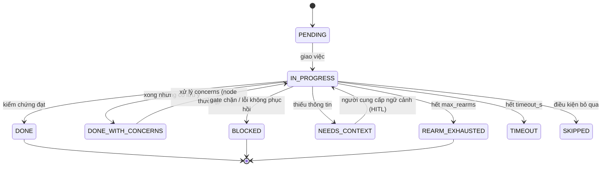

# Trạng thái & State machine Reference

## State machine của node

## Bảng trạng thái

| Trạng thái | Ý nghĩa | Hành động phía hệ thống |
|---|---|---|
| `PENDING` | Chưa chạy, chờ wave tới | — |
| `IN_PROGRESS` | Agent đang thực thi | Theo dõi stall → re-arm |
| `DONE` | Xong, đủ điều kiện | Cho qua (kể cả qua gate) |
| `DONE_WITH_CONCERNS` | Xong nhưng có lưu ý | Gate **chặn** — người duyệt phải xử lý |
| `BLOCKED` | Không tiếp tục được | Báo người vận hành — [Runbook RB-02](/docs/admin-operations/runbook-su-co) |
| `NEEDS_CONTEXT` | Thiếu thông tin | Kích hoạt HITL xin người dùng |
| `SKIPPED` | Bỏ qua theo điều kiện | Ghi lý do vào log |
| `TIMEOUT` | Hết `timeout_s` | Dừng node, đánh giá chạy lại |
| `REARM_EXHAUSTED` | Hết `max_rearms` | Dừng — xem report để sửa brief/ngân sách |

## Quy tắc quan trọng

- **Gate chỉ nhận `DONE`.** Node mang cờ `gate` với `DONE_WITH_CONCERNS` không được qua — tránh
  "xong ẩu" lọt qua cổng duyệt.
- Trạng thái do **hệ thống ghi** (log trung lập), không do agent tự báo —
  [Kiểm chứng độc lập](/docs/architecture/kiem-chung-phuc-hoi/kiem-chung-doc-lap).
- PAUSE/RESUME thao tác ở cấp **run**: dừng ở ranh giới wave, resume từ checkpoint —
  [Phục hồi gián đoạn](/docs/architecture/kiem-chung-phuc-hoi/phuc-hoi-gian-doan).
- Trạng thái chi tiết từng node đọc qua `get_run`/`get_report` hoặc
  [API monitor](/docs/reference/api-rest).
